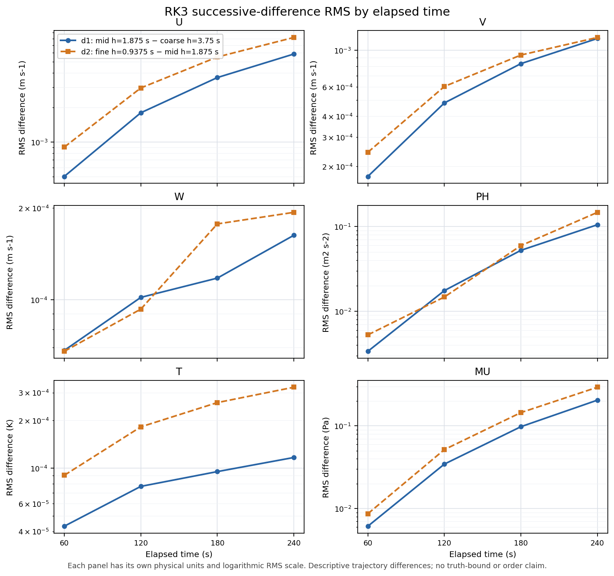

# PR297: archived RK3 reference shape and remaining same-state RHS

Local timestamp: 2026-10-12 07:20:09 JST (+0900)

Base main: `14f330dd4028118a7c135aa16330c15e4c474410` (same Git tree as PR296 HEAD `e74c755`). This is postprocessing and source-contract investigation. No production C++/Fortran, solver options, frozen V3 criteria, or closed rotating inverse case were changed. No production WRF run or local rebuild was performed for this investigation; automatic minimal CI is reported separately.

## What the existing reference ladder shows

The three cold-start dry 16³ `em_b_wave` runs use h=3.75, 1.875, 0.9375 s, a common input SHA `e71b730a12e5a16d181f404f6314e7904e0165eefa622ffd0c508bf8c00dd2a9`, and exact timestamps 0/60/120/180/240 s. All eight raw initial fields are bitwise equal. The existing benchmark loader supplies one authoritative ownership crop: U excludes the duplicate closing face but retains face 0; V includes both physical walls; W/PH omit only the fixed lower face; T/MU retain all mass points. PH comparisons use perturbation geopotential in m²/s². Outer-shell statistics describe the union of first/last retained indices; they are not a separate physical-boundary exclusion rule.

Define `d1=X_1.875-X_3.75`, `d2=X_0.9375-X_1.875`. The new CLI records 24 field/time rows, 48 Float64 delta arrays, RMS/max/mean, per-level and shell concentrations, cosine, and least-squares projection `alpha=<d1,d2>/<d1,d1>` with its residual. Endpoint results:

| Field | Unit | RMS(d1) | RMS(d2) | RMS(d2)/RMS(d1) | cosine(d1,d2) |
| --- | --- | ---: | ---: | ---: | ---: |
| U | m s-1 | 0.0058636674 | 0.0081799797 | 1.39503 | 0.99872 |
| V | m s-1 | 0.0011768122 | 0.00119345667 | 1.01414 | 0.98829 |
| W | m s-1 | 0.000162650886 | 0.000193245407 | 1.18810 | 0.40109 |
| PH | m2 s-2 | 0.105440504 | 0.147633198 | 1.40016 | 0.95436 |
| T | K | 0.000116916543 | 0.000324291339 | 2.77370 | -0.19117 |
| MU | Pa | 0.204999091 | 0.293462215 | 1.43153 | 0.98752 |

All six endpoint difference ratios exceed 1. Across the four checkpoints they range from about 0.84 to 2.77 and their cosines range from −0.426 to 0.999. U/V/MU show strongly aligned differences; W and T do not share a single shrinking shape. These observations do not support third-order Richardson extrapolation on this ladder. They establish neither a formal temporal order nor which trajectory is closer to an exact solution.

A separate spatial-X Fourier audit of U/PH/W/MU at 60 and 240 s finds endpoint U/MU differences predominantly in modes 1–2 (>99%), PH about 95–98%, and W about 68–70%. These are spatial modes of difference fields, not temporal wave frequencies. The mean, high-mode fraction and localized tails remain visible in the raw report. There is no new evidence that the corrected U seam causes this reference behavior.

Independent output-precision checks bound only quantization of saved FP32 fields: at 240 s, the half-ULP difference bound divided by observed RMS is about 2.54e−5/1.82e−5 for U d1/d2, 0.0470/0.0169 for T, and 0.00384/0.00274 for PH. Saved-output rounding alone is smaller than the observed differences. This does not bound accumulated internal FP32 arithmetic or attribute the cause to it.

## Runtime and source conditions

The three namelists differ only in the integer/fractional timestep fields. RSL macro-step counts are 64/128/256 and the exact clock ends at 240 s. Adaptive stepping is off and `time_step_sound=4`; the same RK3 branch uses 1/2/4 acoustic substeps per macro-stage, whose durations scale with h. Non-time physics, boundary, mixing, advection and damping settings match. The first-stage physics/diffusion tendency is reused across the macro-stage sequence, so this is a whole WRF path comparison rather than integrator-only evidence.

The fixed-coefficient acoustic operations are a source-grounded hypothesis to investigate: `smdiv=0.1` modifies pressure using `p−pm1` on positive acoustic steps, `epssm=0.1` enters mass averaging and the vertical solve, and `emdiv=0.01` enters the MUDF wind correction. Their acoustic call counts grow from 448 to 896 to 1,792 over 240 s. The operands and substep durations also change, so call count alone is not an error estimate or causal attribution. Current archives do not isolate those before/after increments. Existing parity diagnostics in `solve_em.F` should be inspected before adding any capture framework.

Coarse/fine executable SHA is `f7c4e1dbb69a3ec68e5376294e326cbaff339531f31dac13ed47e0fcbf413b64`; the middle archive records `2b629416618ddef4ceeea8ba51d07b8a7df514f5df6abab107c51e3f78fcc2de`. The current coarse output matches its preserved older control bitwise across eight variables and five timestamps. Relevant RK/timekeeping source audits show no changed numerical branch, but the middle archive lacks a full runtime environment receipt. Exact same-executable/operator equivalence at every h remains unproven; no formal order claim follows.

## Remaining same-state RHS is a separate problem

The initial and stored PR296 snapshots pass exact physical/storage input gates. On 4,096 owned U faces, subtract the two captured model-to-model diffusion differences in one common unit:

`R_U = (F_CPP−F_WRF)_U − delta_Hdiff_U − delta_Vdiff_U`.

Initial remainder RMS is about `6.48458e−8 m/s²`. Stored remainder RMS is `7.4919237e−8 m/s²`, max `2.6513865e−7` at zero-based physical `[j,k,i]=[13,2,14]` (one-based `[14,3,15]`). Stored seam RMS `7.23289e−8` and interior-X RMS `7.50887e−8` are similar: the residual is distributed and its maximum is internal. Captured horizontal difference RMS is about `6.52e−10`, vertical difference about `1.53e−12`; the corrected terms do not explain the remainder.

The stored full V difference remains `7.62176e−8 m/s²` on 3,840 interior V faces, MU `3.36932e−8 Pa/s` on 256 columns. V physical owners are y=1..15; corrected region labels retain those physical indices. Full-state comparison and forecast masks are distinct, explicitly documented contracts.

The independent Red recomputation matches U/V/MU arrays from both snapshots bitwise and verifies all disjoint counts/norm partitions. Reverse remainder addition differs only by Float64 rounding (max about `5.3e−23`). Norms are not added as if the component vectors were collinear.

No remaining pressure/advection/other term has a full-array isolated comparable capture. The prior bounded pressure/EOS replay at the old hotspot remains valid evidence; it does not capture or explain the present distributed full-array remainder. Existing Fortran W/PH/theta arrays are pre-`rk_addtend_dry`; the full snapshot omits their post-add tendencies. They cannot be compared to the C++ Full result to claim six-equation parity. The corrected U boundaries remain closed; the next missing evidence is a same-state assembled contribution for an unclosed term, not another endpoint run or boundary adjustment.

## Criteria and validation status

The V3 candidate and its PH metadata erratum are unchanged (frozen JSON SHA `77bc4dcc7b8e0bde91d6089e9aaa11a67a49311f824d88c97919bbbb8e64fe3f`). All 24 epsilon/3 reference-qualification rows remain failed. For the fine/middle pair, d2 exceeds 2 epsilon in 3/5/6/6 fields at 60/120/180/240 s. Under a common target and identical norm, those pairs cannot both lie within epsilon; the inequality does not identify the better run. No ARK accuracy acceptance/rejection, project-wide target adoption, or speed superiority is claimed.

The final portable CLI reuses `tools/benchmark_wrf_accuracy_cost.py` and takes `--plan`, `--contract`, `--out`; it has no producer-machine paths. It checks exact times, initial raw arrays, input/namelist bytes and grid, records output hashes, and carries executable hashes as recorded metadata only unless the shared loader is explicitly given executable bytes. The revised CLI reproduced all 24 metrics and 48 arrays from its first draft exactly. The first draft is superseded; final source/results are the portable pair in the evidence bundle.

Green/Red six-agent teams independently reviewed numerical shape, spectrum, provenance, runtime branches, precision, residual closure, and source/result bindings. Audits corrected the V owner-index labels and superseded the first-draft source/plan mismatch. The bounded graph reused 55 exact source bindings and added only FirstPart1 and the analyzer; manually resolved Fortran/runtime edges and extraction gaps are explicit navigation limits.

The reproducible bundle is [pr297_reference_shape_evidence.zip](evidence/20261012/pr297_reference_shape_evidence.zip), with an adjacent SHA-256 receipt. It preserves the three RK3 raw filesets, frozen case metadata, source/producer receipts, remainder inputs and raw arrays, and team analyses. Compiled executable/library bytes remain excluded. Portable extraction verification and final CI status are recorded separately. Existing same-setup whole-process times remain context only: coarse `1.604 s`, middle `1.936 s`, fine `2.209 s`; these are old native run receipts, not new measurements or same-accuracy costs.

## Next bounded question

Reference qualification failure and instantaneous operator discrepancy are different open questions. Existing data establishes their shapes but does not isolate their causes. Choose a single same-state pressure/advection contribution or the missing post-add W/PH/theta capture only after specifying the unit, ownership and assembly contract. A further time-step ladder, optimizer, wave, Hessian, or CI expansion is not a prerequisite for this analysis. Forecast acceptance stays withheld until a justified reference and the unchanged variable-wise criterion can be used together.

Final bundle SHA-256: `8ab675671d72b790ecc25aebcad26a675f9030444a567bd282fd6166318279cc` (85 payloads). [Fresh-extraction verification](evidence/20261012/pr297_offline_verification.json) passed both commands, exactly reproduced all 24 metric rows and 48 delta arrays, and matched every remainder array. All payload hashes/CRCs passed. [Final Red review](evidence/20261012/pr297_final_red_review.md) closes the packaging finding. The numerical analysis source SHA is `aa5fa81a0e9389d92b2d9385d9698f635a21bcff018b39caf668f17aff3bc0fe`; the unchanged authoritative loader SHA is `ccda168475638bcb8bd5a3b26abf127350b31fde08fba0396fa3293c8c9547a8`.
