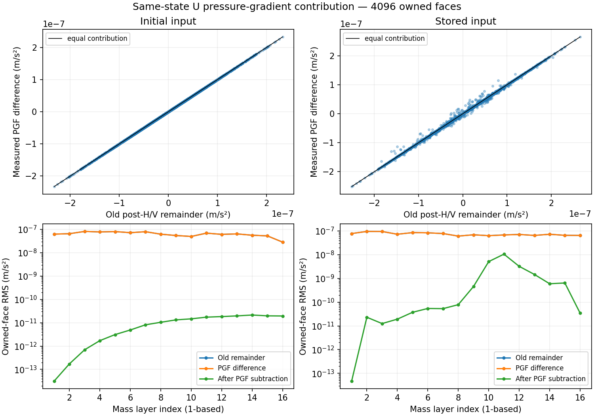

# PR298: actual same-state U pressure gradient and refinement-plan P2

Local timestamp: 2026-10-12 10:34:50 JST (+0900)

Base main: `51527694a3cb139ae43c20532b138e4a65dd6153`, same tree as PR297 HEAD `a3c01dc`. This work closes the small analyzer declaration P2 and measures the actual U pressure-gradient contribution requested by the review. Production equations, pressure choices, nonlinear tolerances and physical settings are unchanged. Only opt-in observations were added to the existing Fortran/C++ calls.

## Analyzer input contract

`tools/analyze_wrf_reference_refinement.py` now requires the normalized loaded declarations `coarse_h3p75=3.75`, `middle_h1p875=1.875`, `fine_h0p9375=0.9375` seconds and method `RK3`. Contradictions raise a label/value-specific `ValueError`. The existing loader keeps responsibility for finite positive values and file/grid/input checks; no new metadata framework or parser was introduced.

Three focused tests call the real analyzer with mocked file boundaries: the valid plan emits 24 metrics/48 arrays, swapped steps reject, and another method rejects. The old PR297 analyzer accepts both invalid archived plans; the new one rejects both. A normal archived reanalysis reproduces all 24 metric dictionaries and 48 arrays elementwise. Frozen V3 SHA stays `77bc4dcc7b8e0bde91d6089e9aaa11a67a49311f824d88c97919bbbb8e64fe3f`.

## Native evidence and actual call identity

Four authorized 15-second calls used the two existing initial inputs: original SHA `e71b730a12e5a16d181f404f6314e7904e0165eefa622ffd0c508bf8c00dd2a9` and stored-state SHA `90bec3e95b2b98c9281d5b0ffbd7a16124e9611273b8a7318056ef8337b8aea4`. Each input has one Fortran RK3 h=15 call and one native ARK mode-3 h=15 call, one rank/thread, dry flat 16³, periodic X/symmetric Y, zero measured QVAPOR/QV_BASE. All four exit 0 with SUCCESS COMPLETE. No new 240-second forecast, reference refinement, rotating inverse or optimizer was run.

The Fortran observer brackets the existing `horizontal_pressure_gradient` call in `module_em.F` and records before/after RU/RV, actual U/V/W/T/PH/MU, pressure/inverse-density/geometry/mass/coefficient operands and flags. Its first-eligible RK1/full-tile/single-rank guard records `n_moist=2`; no-microphysics does not imply an empty moisture registry. The C++ observer is on the real `computeUnifiedRHS` Full/canonical mode-3 path, not split-explicit emulation. It requires the packed single-rank domain and records the same-call input state, scaled/unscaled PGF, velocity mass, alpha denominator, native-NH flag and P′/AL′/ALT/PH sidecar. Both use the existing `WRF_PARITY_RK_TEND_DUMP=1`; default off, no additional RHS evaluation or pressure replacement.

Direct actual-call six-state equality to each Full snapshot, physical/storage equality across Fortran/C++, periodic U aliases, and equality to the old remainder's input state all pass for both inputs. Thus the comparison is tied to actual call states, not an assumed matching stage label. Fortran pressure at this first large-step PGF call precedes acoustic `calc_p_rho` history filtering. The two captured pressure contexts are nonhydrostatic with top lid false. No later-stage, warm-restart or MPI generalization follows.

## Common physical units and component accounting

Fortran is mass-coupled. Its PGF-only increment is

`u_dot_PGF = (RU_after − RU_before)*msfuy/(c1h*muu+c2h)`.

The PGF component has zero column-mass RHS, so this partial force has no `−u*c1h*MU_dot` term. That product-rule correction remains part of the full RHS conversion. C++ is normalized using actual `scaled_PGF/velocity_mass_u`; it equals `unscaled_PGF/alpha_u` within `1.09e−19` maximum. Comparisons retain all 4,096 unique physical U faces including x=0, excluding only the closing alias. The 4,352 saved-row normalization audit is labeled separately.

Let `R_old=Full_CPP−Full_FT−delta_Hdiff−delta_Vdiff`, and form `R_after=R_old−(PGF_CPP−PGF_FT)` elementwise. Neither RMS subtraction nor removal of physical boundary faces is used.

| Input | Old remainder RMS | PGF difference RMS | After PGF subtraction RMS | Uncentered cosine | Squared-residual reduction |
| --- | ---: | ---: | ---: | ---: | ---: |
| initial | 6.48457712e-08 | 6.48456753e-08 | 1.33601795e-11 | 0.999999979 | 99.999996% |
| stored | 7.49192367e-08 | 7.4857719e-08 | 3.06900489e-09 | 0.999160616 | 99.832194% |

All acceleration values are m/s². Initial after-subtraction max is `6.78544e−11`; stored max remains `3.43776e−8`. Stored x=0 RMS is `2.90144e−9`, x=1..15 `3.07985e−9`. This is an error-budget subtraction, not a production equation correction or forecast improvement. The actual full RHS values remain those of the same equations. A stored remainder is still measurable and unassigned; it must not be called roundoff-certified or automatically attributed to transport.

## Source equation and pressure-operand evidence

The independent Fortran A–D FP64 replay uses actual captured operands: geopotential gradient, ALT×P′ gradient, AL′×PB gradient, and the NH PHP/dpn/mu term. Its difference from the actual FP32 accumulator increment is RMS `2.70e−11` initial / `2.80e−11` stored. The accumulator endpoint half-ULP scale is `1.66e−11` RMS; it covers endpoint resolution only, not all intermediate arithmetic. The initial after-subtraction remainder is at that scale, while the stored remainder is about 109 times the source-oracle RMS scale.

The actual P′ operands differ by approximately `0.00481/0.00515 Pa` RMS (initial/stored); PH is exact, AL′/ALT are about `5e−8` relative RMS. The B pressure contribution tracks nearly all of the measured PGF difference. A correct-dtype, effective-top-lid C++ A–D replay matches the captured total to about `3.2e−11 m/s²` RMS in both cases. An earlier replay incorrectly used native-NH as the top-lid flag and rounded C++ PHP to FP32; it is preserved as superseded and does not establish a production NH defect.

Pressure/EOS replay is consistent with an arithmetic/operand difference: C++ P′ agrees with FP64 EOS replay on its own operands to about `1e−12 Pa`, whereas FP64 replay on Fortran operands differs from Fortran P′ by about `3e−3 Pa`. Total-pressure FP32 spacing is thousands of times larger than the stored P′ spacing, so snapshot P′ ULPs alone cannot bound internal cancellation. Fortran pressure producer/history before this capture is not observed directly. The namelist declares hypsometric option2, whereas the C++ log reports effective option1 for ideal cases; this is retained as a pressure-control limit. The replay separates an ALT-sensitive contribution from the residual between stored Fortran P′ and its replay, consistent with FP32 cancellation without identifying the exact producer. This does not prove a single exclusive mechanism or justify forcing FP32 arithmetic into the differentiable path. No pressure source, precision policy or filter coefficient was changed. It also does not establish the cause of the separate RK3 time-sensitivity failure.

## Build, regressions and limits

Unchanged authoritative sources were byte-verified against the prior native build before object reuse; affected C++/`module_em.F` objects were rebuilt with matching headers. Generated `module_em.f90`, object/archive and executable freshness are verified. `module_em.mod` hash is exactly the baseline hash (interface unchanged). MYNN source dependency was initialized at the pinned gitlink and its resolved source bytes checked. The compiler-triggered WRF dependency rebuild completed successfully.

Executable SHA: `4201790d363fb9bdc1e49bf9a83fd3a506b91147c1b34b8a8fbbc0ff77e22ec3`; C++ library SHA: `21f7bc79a131f4608f506259b7c0434f2350749486774f14aea260cc69910565`. Actual g++/gfortran/OpenMPI/netCDF/libtorch paths and link commands are recorded. Generic nc-config/nf-config queries resolved MacPorts; explicit Homebrew queries and the real link/otool paths bind netCDF 4.9.3 / Fortran 4.6.2. Existing auxiliary diffwrf/test_io_idx link errors were ignored by the build; they are distinct from successful WRF/ideal executables.

The four histories match archived fixed_xy files byte-for-byte across all 188 variables, but only contain t=0. This is initial-output noninterference evidence, not +15 s forecast parity. Current Full-U snapshots and whole deltas equal the prior values bitwise. Short call runtimes are recorded as launch-to-exit context; there is no same-accuracy efficiency comparison in this investigation.

Green/Red six-agent teams reviewed source calls, unit/scaling/state contracts, generated-source lineage, native hashes and independent arrays. Audits corrected external parser field order and moisture-count assumptions, PHP/top-lid replay errors, and one independent mass broadcast axis. Corrected final reports reproduce each other; superseded results are clearly marked and excluded from current numerical claims. The graph is source-bound with extraction gaps explicit; relationships guide navigation, not numerical proof.

The native source bytes are bound to producer commit `05137f9c62ef01c3e9532dda918e8fc2c66d51c8`: all seven recorded before/after source hashes match the committed blobs. Documentation commits do not change the compiled sources.

The evidence bundle is [pr298_u_pgf_evidence.zip](evidence/20261012/pr298_u_pgf_evidence.zip), with adjacent SHA-256 and [fresh-extraction verification](evidence/20261012/pr298_portable_verification.json). All 155 manifest payloads hash correctly; both actual state gates and every final pressure-budget array reproduce exactly, and three P2 tests pass. ZIP SHA-256 is `78fa7d2eb06072800dca6d175e3f2edc24767b7d67689c4b9a6cc6a262c3bc35`. It contains raw paired calls, inputs, source/build pins, P2 tests and analysis code; executable/library bytes are retained locally and hashes distributed. Local and automatic minimum CI results are distinguished; the new P2 tests are local and are not added to the remote selected CTest list. Original auxiliary investigation scripts retain historical machine paths; the bundled `verify_bundle.py` and its primary analyzer/P2-test dependency path are the portable entrypoints.

Completed scope: P2 declaration contract fixed; same-state Full U pressure contribution collected and its measured discrepancy assigned most of the post-H/V remainder. Open scope: stored remainder, W/PH/theta post-add RHS, full six-equation parity, integrated observation-window JVP/VJP, and qualified RK3 reference/forecast acceptance. The fixed V3 gate still fails all 24 rows, the project-wide accuracy target is not adopted, and the completed rotating inverse remains closed.

Final package follow-up: prepackage missing-ZIP observations in the Green/Red review notes are explicitly historical and closed by their timestamped follow-ups. Their examined first package SHA differs from the final package because these audit notes were then included; the adjacent final SHA and fresh-extraction receipt bind the delivered archive.
