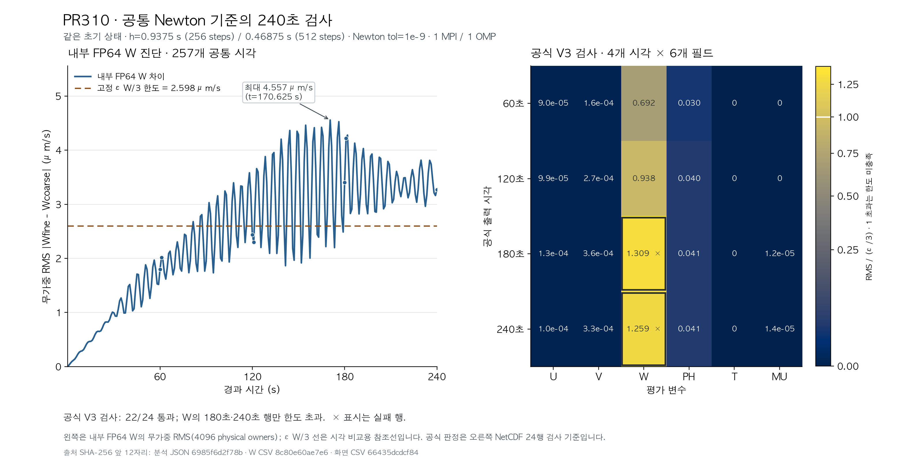

# 공통 Newton 기준의 240초 ARK 기준해 검사

기록 시각: 2026-10-20T10:44:47+09:00 (JST)
기준 소스: `9614e78dbd71250f571f0e495650eeca1e209a04`, tree `24f37b93aa7f93eefe2b291de019fa6a6754474d`
외부 근거: `/Users/yhlee/AD-SDIRK3-review-evidence/strict-reference-240s-20261020`

## 결과와 범위

PR309의 strict 계열을 원래 e71 초기장에서 240초까지 연속 계산했다. 기존 V3 영역과 예산으로 **24개 검사 중 22개가 충족**됐다. 60·120초의 여섯 변수는 모두 충족하고, **W의 180·240초 두 행은 미충족**이다. 따라서 전체 기준해 적격성과 보존된 `h=15 s` 후보의 공식 정확도 판정은 계속 보류한다. 새 시간간격·초기조건·감쇠·생산 허용오차를 추가하거나 변경하지 않았다.

이 작업으로 0–240초 두 계산과 전체 24개 판정을 완료했다. 통과할 때까지 추가 세분화를 반복하는 계획은 아니다. 기존 `Newton=1e-7` 계열의 20/24 기록과 이번 `1e-9` 계열의 22/24를 섞지 않는다.

## 실행과 소스 연결

| 경로 | h (s) | 모델 스텝 | 암시적 단계 | 실패 | 관찰 포함 wall (s) |
|---|---:|---:|---:|---:|---:|
| coarse | 0.9375 | 256 | 768 | 0 | 872.94 |
| fine | 0.46875 | 512 | 1,536 | 0 | 1,673.05 |

두 경로 모두 원래 초기장부터 연속 적분했으며 60초 상태만 읽는 cold restart를 사용하지 않았다. Newton 절대 기준 `1e-9`, 상대 기준 0, Krylov `1e-7`, 유효 EWT `1e-6`, MPI 1 rank·OMP 1 thread를 유지했다. `scheme=6`, mode 3, split-explicit 비활성, native `phi_adv_z=1`/scalar 연직 차수 3, `kdamp=0.2`, option-2 확산 `KHDIF=1000`/`KVDIF=10`도 유지했다. stock RK3의 음향 필터 계열과 혼합하지 않는다.

각 실행은 반환 코드 0과 `SUCCESS COMPLETE WRF`로 종료했다. 실제 NetCDF `Times`는 0–240초의 15초 간격 17개이며, U/V/W/PH/T/THM/MU/MUB는 모두 유한했다. 실행시간에는 대형 단계 관찰 출력과 현재 호스트 부하가 포함되므로 효율 우위의 근거로 쓰지 않는다.

실행파일 SHA `5bf90cd95e6d5ac4a5a76f73ec407d9ee6e91c1b6919488df20c9df09a2a7769`, C++ archive `dd87b49aa448a88e13ba2047fd75b433d785f112ab485483ae439ba5035f32c5`, Fortran archive `11e6b42861a85d1ecfd4774c4272da71cb46e41a38c57c24d28b525cee09ad15`, 입력 `e71b730a12e5a16d181f404f6314e7904e0165eefa622ffd0c508bf8c00dd2a9`를 고정했다. 관련 생산 소스 28개는 보존된 빌드 소스 bytes와 같아 재빌드하지 않았다. [PR307 빌드 기록](evidence/pr307_accepted_ark_w/pr307_v2_build_receipt.json)은 Apple clang 21.0.0/C++17, libtorch 2.10.0, Open MPI 5.0.9 및 정확한 archive·객체 연결을 기록한다. 현재 dylib 경로·해시도 별도로 보존했다. 빌드 당시 dirty HEAD 이름만으로 실행파일을 인증하지 않는다.

실행 전 고정한 protocol SHA는 `af8e50eeba754a9c2e95b99495b4649374cf4afa66f3d6c48506761e6549e3ad`, launch binding은 `8d224408c418f36ef1a4588b5f5e4d2857722d50f29d3e816c708d82c5ab90f5`다. 이 계획은 어느 행이 실패하더라도 건강한 두 계산을 240초까지 마치고, 추가 모델 실행 없이 결과를 보고하도록 고정했다.

## 고정한 24개 판정

공개 FP32 NetCDF 값을 FP64로 승격한 뒤 차감한다. T는 `T+300 K`, MU는 `MU+MUB Pa`, PH는 지오포텐셜 섭동이다. U의 X 중복면과 W/PH의 고정 하단만 제외하며, V의 두 Y벽과 W/PH의 동적 상단은 포함한다. 소유점 수는 U/V/W/PH/T/MU 순서로 4096/4352/4096/4096/4096/256이다.

각 행은 기존 `RMS <= epsilon_X/3`로 판정했다. W 한도는 `2.5981466189324436e-6 m/s`다.

| 시각 (s) | W fine−coarse RMS (m/s) | W 한도 대비 | W 판정 | 나머지 다섯 변수 |
|---:|---:|---:|---|---|
| 60 | 1.79844364972647e-6 | 0.692203 | 충족 | 5/5 충족 |
| 120 | 2.43727110680887e-6 | 0.938081 | 충족 | 5/5 충족 |
| 180 | 3.40106637566807e-6 | 1.309036 | 미충족 | 5/5 충족 |
| 240 | 3.27151664904935e-6 | 1.259173 | 미충족 | 5/5 충족 |

다른 다섯 변수의 최대 한도 대비 비율은 PH 180초의 `0.0407407`이다. T의 네 시각 0과 MU의 60·120초 0은 저장 FP32 출력에서의 일치다. 내부 상태나 모든 시각의 정확한 일치라는 뜻이 아니다. 두 계산 사이의 거리 역시 참오차 상한이나 3차 수렴의 증명이 아니다.

최초 미충족 **공식 평가시각**은 180초다. 사전 규칙에 따라 상세 보존 구간은 `[179.0625,180] s`, coarse 192스텝과 fine 383·384스텝이다. 각 실행의 첫 스텝을 더해 총 다섯 모델 스텝의 전체 단계 CSV를 보존한다. 내부 W의 다른 기록시각에서 한도를 넘는지는 별도 진단이며, 이 공식 평가시각 선택을 바꾸지 않는다.

## 내부 상태·풀이잔차와 독립 검산

Green 최종 자료와 Red 첫 독립 스트림의 전체 NPZ 배열은 바이트 단위로 일치했고, 두 분석의 24개 행도 Root의 독립 NetCDF 재계산과 정확히 일치했다. 두 경로의 60초 여섯 packed 상태는 PR309 대응 자료와 일치한다. 내부 FP64 W를 FP32로 변환한 값도 양쪽 17개 공개 W 기록, 총 34개 배열과 정확히 같다.

공통 시각은 `t=j×15/16 s`, fine의 `2j` 스텝으로 대응했다. 내부 W 257개 공통 시각의 최대 차이는 **170.625초의 `4.55712645847e-6 m/s`**다. 기록시각에서 관찰선 `epsilon_W/3`를 처음 넘은 시각은 81.5625초였다. 따라서 120초 공식 끝점의 통과를 0–120초 모든 기록시각의 통과로 읽으면 안 된다. 내부선 초과는 별도 진단이며, 사전 고정한 공식 평가시각과 상세 보존 규칙을 바꾸지 않았다. 고정 M0/e1은 재계산하거나 결과에 맞춰 조정하지 않았다.

Green의 전체 풀이 요약은 다음과 같다. 두 경로 모두 모든 암시적 단계의 Newton count가 2로, 초기 검사 후 한 번 보정했다. Krylov 최댓값은 양쪽 13이고 retry는 없다.

| 경로 | 최종 정규화 잔차 최대 | W 단계 G의 최대 RMS (m/s) | 직접 W 잔차 기여 합 (m/s) |
|---|---:|---:|---:|
| coarse | 7.81828e-15 | 1.63751e-14 | 1.23290950e-11 |
| fine | 2.19945e-15 | 5.18542e-15 | 1.16964031e-11 |

Red의 첫 스트림은 24행·전체 W 배열을 완결했지만 CSV 출력 열 누락으로 단계 스칼라 요약을 저장하지 못했다. 원래 부분 산출물과 실패 기록을 보존하고, 동일 원자료를 다시 읽는 오프라인 복구를 한 번 허용했다. 수정은 직렬화 필드 목록과 저장 검사에 한정되며 모델·판정·수치식은 바꾸지 않았다. 복구가 완료돼 전체 2,304개 암시적 단계의 요약을 독립 비교했다. G 통계의 최대 차이는 `3.16e-30 m/s`, K−FI는 `6.31e-30 m/s²`, 스텝별 직접 기여 합은 `1.26e-29 m/s`였다. 최종 정규화 잔차와 Newton/Krylov 횟수는 같았다.

79개 NPZ 배열의 바이트 일치는 **Green 원본, Red 첫 부분 산출물, Red 복구 산출물** 사이의 비교다. 원시 단계 자료를 수치 분석한 독립 구현은 두 개이며 Root가 세 번째 W NPZ를 만들었다는 뜻이 아니다. Root는 원래 NetCDF 24행을 직접 재계산하고, 배열·스칼라 일치 및 34개 W 공개 정밀도 연결을 별도로 확인했다.

coarse의 실제 60초 packed 상태 24,531개와 처음 65개 내부 W 끝값은 PR309 대응 자료와 바이트 단위로 일치했다. Green/Red coarse compact도 모든 W 끝값과 input/final/t60 packed 상태가 바이트 단위로 같다. 두 분석의 W G RMS 최대 차이는 `3.16e-30 m/s`이며, 직접 잔차 합의 차이는 `1.26e-29 m/s`다. 기존 coarse 원본을 다시 파싱하지 않고 검증된 캐시를 재사용한다.

명시적 첫 단계에는 Newton 잔차를 부여하지 않는다. 암시적 단계의 `G = h*a_ii*(K-FI)`는 같은 단계식을 다른 단위로 표현한 연결이며 독립적인 두 증거로 세지 않는다. 단계별 직접 잔차 기여의 합은 이후 전파·역 Jacobian 증폭을 포함한 전역 오차 상한이 아니다.

## 실행 관리 메타데이터 정정

coarse 관리 도구의 예상 시각 생성이 초를 분처럼 표시했다. 모델 namelist와 실제 NetCDF 17개 시각은 올바르며, 모델 재실행은 하지 않았다. 원래 runner와 원래 receipt를 보존하고 별도의 corrected full receipt로 연결했다. Root 대조에서 실행파일·입력·명령, 원시 CSV/NetCDF 해시 목록과 실제 Times는 그대로였다. fine은 ISO 연·월·일과 초를 정확히 생성하는 관리 도구로 시작해 원래 receipt의 시각 검사가 통과했다. 이는 생산 수치식 수정이 아니다.

Red의 오프라인 독립 분석기도 두 완료 receipt의 동등한 필드 이름을 엄격히 읽도록 보완했다. 기존 coarse 분석 소스와 새 fine 분석 소스를 모두 해시로 보존하고, 수치 파싱·G/K−FI·소유면·예산·선택 규칙이 바뀌지 않았음을 확인했다.

## 보존 stock RK3와의 보조 비교

같은 e71 초기장과 16³ 격자의 보존된 stock RK3 `h=1.875 s`에서 실제 240초 프레임을 재사용했다. 새 RK3 적분이나 시간 보간은 없다.

| 변수 | fine ARK−stock RK3 240초 RMS 거리 |
|---|---:|
| U (m/s) | 0.0135072 |
| V (m/s) | 0.00357188 |
| W (m/s) | 3.19882e-4 |
| PH (m²/s²) | 0.257212 |
| T+300 (K) | 1.11423e-4 |
| MU+MUB (Pa) | 0.504089 |

stock RK3의 split-explicit 필터 정책은 이번 native mode-3 정책과 다르다. 이 표는 보조 거리이며 기준해·참오차가 아니다. 보존 분석의 stock 실행시간 기록 `1.93578 s`에는 직접 wall receipt 출처가 없고, 이번 fine `1673.05 s`에는 관찰 출력이 포함돼 있어 속도 비율을 계산하지 않았다.

## 보존과 다음 범위

[공개 재계산 묶음](evidence/pr310_strict_reference_240s/README.md)은 약 24.9 MB NPZ, 고정 protocol, NumPy 재계산기와 해시 manifest를 제공한다. 네 파일만 새 폴더에 복사해 실행했고 원래 NetCDF·WRF·분석 helper 없이 같은 22/24 판정과 내부 W 최대값을 재현했다. 이미 물리 변환·소유면을 적용한 배열이므로 T의 300 K나 MUB를 다시 더하지 않는다. 유도 가능한 차이장과 실제로 소유 W 값이 같은 raw/projected 끝값의 중복 저장을 줄였다.

새로 만든 임시 단계 CSV 768개는 총 `23,031,718,152`바이트였다. 두 독립 분석의 모든 해시·상태 전달·실제 설정·스칼라 합의를 확인한 뒤, 사전에 선택한 다섯 파일 `147,043,773`바이트를 재해시해 보존했다. 비선택 763개, `22,884,674,379`바이트는 정리하고 원래 SHA·크기·경로와 제거 사실을 [보존 영수증](evidence/pr310_strict_reference_240s/raw_csv_retention_manifest.json)에 기록했다. 전체 단계 배열을 무손실 보존했다고 주장하지 않는다. 모든 NetCDF·로그·입력·실행파일과 이전 PR의 보존 근거는 그대로다.

Graphify는 소스 해시가 같은 생산 그래프를 재사용하고, 변경된 오프라인 도구와 그림 생성기만 작은 AST corpus로 연결했다. coarse/fine compaction 소스와 후속 CSV 직렬화·receipt 호환성 보완 소스를 버전별로 보존했다. 구조 그래프는 탐색 보조이며 수치 검증을 대신하지 않는다.

전체 strict 기준은 아직 미충족이다. `h=15 s` 후보는 새로 실행하지 않았고, 사전에 정한 24/24 조건이 성립하지 않아 공식 정확도 판정을 수행하지 않았다. 이미 완료한 입력 THM/W·압력 생성·CF·PH/THM 수송·EMDIV 원인·회전파 연구는 다시 열지 않았다. 일반 관측창 수반, 별도 C++/통합 C++ U/V 연결 차이, THM Taylor 미결은 기존의 독립적인 미완료 범위로 남는다.

다음 조사는 보존된 수용 스텝의 W 끝값 궤적과 180초 공식 미충족 구간을 사용해 남은 차이를 해석하는 범위로 좁힌다. 이 결과만으로 초기 압력·W를 바꾸거나, 감쇠를 조정하거나, 생산 Newton 기준을 일괄 변경하지 않는다. 새 시간간격 사다리·추가 240초 계산·예산 완화는 이번 작업에 포함하지 않는다.

수치·보존 근거 갱신: 2026-10-20T11:11:31+09:00

최종 종료 검토: Green·Red 모두 PASS, 남은 P0/P1/P2 지적 없음. 이는 자료·보고 범위의 종료 검토이며 22/24인 기준해를 수용한 판정은 아니다. [Green](evidence/pr310_strict_reference_240s/final_green_review.json) · [Red](evidence/pr310_strict_reference_240s/final_red_review.json).

최종 문서 갱신: 2026-10-20T11:15:35+09:00
