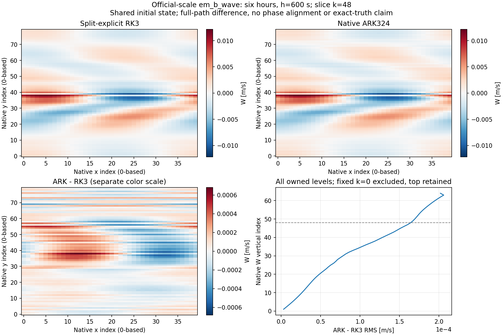

# 표준 em_b_wave ARK600 — 첫 6시간 정상 완주, RK3 대비 큰 계산비용 확인

최종 갱신 시각: 2026-10-24 14:34:34 JST (UTC+09:00)

사용자가 선택한 **모델시간 6시간 점검**을 수행했다. 공식 규모·100 km의 같은 초기장에서 ARK324를 h=600초로 36스텝 연속 적분했고, 종료 코드 0으로 완료했다. 암시적 단계 108개가 모두 수렴했고 강제 단계 실패·재시도·다른 적분법으로의 fallback이 없다. 이 결과는 첫 6시간의 실행 가능성 근거이며 5일 안정성이나 정확도 수용을 뜻하지 않는다.

계산비용은 현재 구현의 중요한 약점이다. 같은 6시간의 RSL main-step 구간은 ARK **2,316.896초**, RK3 **4.77343초**로 약 **485.37배**다. 이 값은 같은 정확도에서의 속도비가 아니다. RK3의 5일 전체 wall time과 ARK의 6시간 wall time을 나누지도 않았다.

## 실행 규약과 변경 범위

기존 [5일 RK3 기준 실행](<(202610241316)_standard_forward_rk3_baseline_and_ark_pending.md>)의 공간·건조 물리·입력·실행파일을 재사용했다. 명목 격자는 41×81×65, 질량 격자는 40×80×64다. `diff_opt=1`, Kh=Kv=0, 주기 X·대칭 Y, 출력 간격 6시간을 유지한다. 실제 RK3는 selector 0, ARK는 selector 6·IMEX mode 3이다.

새 `six_hour_runs/ark_h600` 디렉터리를 사용했다. 5일 lean namelist에서 바꾼 것은 `run_days:5→0`, `run_hours:0→6`, `end_day:06→01`, `end_hour:00→06` 네 줄뿐이다. 6시간에 정상 종료하도록 설정했으며 중간 상태를 읽는 cold restart나 수동 신호 중지는 사용하지 않았다. 원래 초기장 생성과 RK3를 다시 실행하지 않았다. 사용자 승인 범위를 반영해 복사된 manifest의 이전 “답변 대기” 문구만 별도 수정·해시 연결했다.

| 고정 항목 | SHA-256 또는 값 |
|---|---|
| 과학 소스 기준 | `72512fc09f5f0ca7a28306b9aaad949719ef0b74` |
| 분석기·문서 작업 기준 커밋 | `95ba8a6c331f84741aa2d4b5310b9eb88b139c2e` |
| 공통 실행파일 | `036b86a619a5cbf79e969b3d7d8af9c612125c0d1438258c42fde501142dd497` |
| 공통 wrfinput | `c3e56611954a5f9c1de107b7c86ecef0a5ff0ea5456cf94f26abfaf31e9bf912` |
| 6시간 namelist | `c82bb96cb9c5ede93c65a15f1fb9b99329c42cc7d556121067947b49246691f7` |
| 6시간 최종 manifest | `1a7d1bb2b78c7717efdb2f58b460196cb47e391b309926cf8502088ec657b480` |
| 실행기 | `dcb36ac6d1257b938848314794e2b16f9b90ea32f04e184192db325042553869` |
| Newton·Krylov | 절대 1e-9·상대 0·최대 40회; 1e-7·최대 100회·restart 30 |
| 상태·미분 | 내부 FP64 연속 전달, Newton AD JVP 유지, 자료동화 호출·수반 그래프 보존 없음 |
| 자원 | MPI 1 rank, 계산 스레드 환경값 1, 실시간 한도 6시간 |

실행파일에는 `dfc5ba8e3ed64a121425bda43480fabc32be8258`의 query-free 종료 관찰 소스가 명시적으로 포함된다. 해당 소스·객체·링크·컴파일러/MPI/libtorch/netCDF 핀은 이전 빌드 영수증과 같다. 과학 HEAD 하나만으로 실행파일 출처 전체를 대표하지 않는다.

이전 관찰기 시험과 달리 `WRF_SDIRK3_RHS_COUNT`를 제거했고 실제 RHS digest 기록도 없다. 물리식·공개 ABI·허용오차를 바꿔 성공을 만든 것이 아니다. RK3 음파 필터와 ARK의 암시적 발산 처리(kdamp=0.2)는 여전히 다르므로 **전체 전방 경로의 비교**다.

## 정상작동·물리 허용성

- [x] 실제 t=0 history에서 21개 상태·기본장·좌표 배열과 8개 속성이 RK3와 일치
- [x] 600초 간격의 36스텝·암시적 단계 108개 수렴
- [x] 종료 코드 0, WRF 완료 표식, 소유 프로세스 정리 완료
- [x] 시작·6시간 출력의 유한값·양의 총 온위·총 기둥질량·층두께·총압
- [x] 보존된 RK3 600/300/150초의 6시간 끝값 비교와 RK3 내부 민감도 분리
- [ ] ARK 300/150초·5일 연속 적분과 전체 시간간격 비교 — 이번에는 실행하지 않음
- [ ] 새 물리 정확도 예산과 동일 정확도 비용 수용 — 아직 정의·검증되지 않음

로그의 보고값은 모든 단계에서 `iters=3`이다. `wrf_sdirk3_newton_solver.cpp`는 0부터 시작하는 루프에서 수렴 검사 후 `newton_iter+1`을 기록한다. 따라서 이는 단계마다 **잔차검사 3회·Newton 보정 2회**, 합계 보고 반복 324회·보정 216회에 해당한다. 진행 중의 “보정 3회” 표현은 이 구분으로 정정한다. 정규화 잔차를 물리 상태 참오차로 해석하지 않는다.

저장된 두 시각 전체에서 최소 총 온위는 258.839355 K, 기둥질량은 89,042.9349 Pa, 층두께는 215.109791 m, 총압은 11,079.9640 Pa다. 이는 출력 상태 검사이며 모든 내부 단계의 점별 물리 성질을 별도로 인증한 것은 아니다. 최대 CFL의 시공간 배열은 수집하지 않았으므로 CFL 경고 부재를 특정 최대 CFL 값의 보증으로 바꾸지 않는다.

## 같은 시각의 예측장 차이

6시간의 **ARK600−RK3 600**을 공통 물리 소유 영역에서 직접 FP64로 차감했다. 원자료는 공개 FP32 NetCDF 출력이다. U 주기 중복면과 W·PH 고정 하단은 제외하고, V 물리 벽과 W·PH 동적 상단은 포함한다. T+300 K는 건조 총 온위이고 기온이 아니다. 같은 상수를 더해도 T 차이는 동일하다.

| 변수 | 단위 | RMS 거리 | 최대 절대차 | 평균차 |
|---|---|---:|---:|---:|
| U | m/s | 0.00233010566 | 0.00936698914 | 6.98869e-6 |
| V | m/s | 0.00237689516 | 0.0115006417 | −7.11247e-5 |
| W | m/s | 0.000118946940 | 0.000681472011 | 5.67090e-7 |
| PH | m²/s² | 0.762312778 | 3.89990234 | −0.001167858 |
| T | K | 0.00194097692 | 0.0196838379 | −1.24961e-6 |
| MU | Pa | 1.24624285 | 4.00965309 | −1.25659e-6 |
| P+PB | Pa | 0.562498498 | 4.27961349 | 0.000813179 |

W의 거리는 RK3 끝값 RMS의 약 6.45%다. 이것은 방법 간 상대 거리이며 6.45% 참오차라는 뜻이 아니다. 해당 시각의 RK3 내부 W 거리는 600/300초에서 2.07387e-5 m/s, 300/150초에서 3.29175e-5 m/s로 단조 감소하지 않는다. 150초 RK3를 정확해나 수렴 완료 기준해로 삼지 않는다. ARK 내부 세분화 자료가 없으므로 이번 한 점만으로 순수 시간적분 오차와 지속적인 필터·연산자 차이를 분리할 수 없다.

W 최대차는 내부 native k=48, y=38, x=13(수평 인덱스 0부터)에 있다. 상단 네 수준의 제곱차 비중은 18.09%, 마지막 수준은 4.51%, Y 처음·마지막 두 행은 합계 1.45%다. 이는 차이가 오직 한 경계에만 국한되지 않는다는 진단이며 특정 경계 구현을 인증하거나 오류 원인을 확정한 것은 아니다.

두 예측장은 같은 색 범위를 사용한다. 차이장은 별도 범위를 명시했으며 위상 이동·진폭 보정 없이 그렸다. 수평 단면은 최대차가 있는 k=48을 선택했고, 모든 소유 연직 수준의 RMS도 함께 표시했다. 이 단면 하나를 전체 장의 오차로 대신하지 않는다.

같은 6시간의 zonal mode 1 진단은 다음과 같다. 위상은 `arg(sum(C_ARK*conj(C_RK3)))`이며 공간 정렬을 하지 않았다. T는 온위 섭동, P는 압력 섭동의 모드다. 전체 장이나 모든 파수의 정확도 인증으로 확대하지 않는다.

| 진단량 | ARK/RK3 진폭비 | ARK−RK3 위상(rad) | coherence |
|---|---:|---:|---:|
| T | 1.005145 | 0.0015410 | 0.999902 |
| W | 1.004131 | −0.0204480 | 0.998559 |
| P | 1.061042 | 0.0134750 | 0.998245 |

저장 출력으로 계산한 6시간 건조질량 상대 변화는 ARK −5.64e-14, RK3 600초 +1.40e-11이며 질량가중 온위 변화는 각각 +6.77e-9 K, −5.98e-8 K다. 출력 정밀도와 진단 산식을 포함한 값이며 연속 방정식의 엄밀한 수지 오차나 그 자릿수의 물리 정확도를 보증하지 않는다. 새로운 보존 합격 기준으로 사용하지 않았다.

## 계산비용과 종료 경로

| 계산 | 모델시간 | RSL main-step 시간 | 전체 wall time |
|---|---:|---:|---:|
| RK3 h600 기존 연속 실행의 첫 36스텝 | 6시간 | 4.77343초 | 6시간 단독 측정 없음 |
| RK3 h300 기존 연속 실행의 첫 72스텝 | 6시간 | 11.56449초 | 6시간 단독 측정 없음 |
| RK3 h150 기존 연속 실행의 첫 144스텝 | 6시간 | 18.27228초 | 6시간 단독 측정 없음 |
| ARK h600 이번 36스텝 | 6시간 | 2,316.896초 | 2,318.040734초 |

비용 비교는 같은 모델시간의 **RSL 적분 구간끼리만** 수행한다. ARK600/RK3 600 비는 485.3734다. ARK 전체 wall time은 약 38분 38초이며, 최대 관찰 프로세스 트리 RSS는 2,269,577,216 bytes다. RSS는 표본값이고 실행 조건당 한 번의 기록이므로 정확한 최대값이나 시간 분산을 인증하지 않는다. 각 계산의 출력 정책·환경·컴파일 핀과 실제 스레드 스냅샷은 영수증에 있다.

보정 216회의 JVP 요약을 합하면 **8,146회·1,546.37155초**이며, RSL main-step 시간의 약 **66.74%**다. 소스는 Newton 보정마다 카운터와 타이머를 초기화하므로 단계 누적값을 중복 합산한 것이 아니다. 이는 로그가 측정한 JVP 경로의 시간이며 전체 CPU 프로파일이나 나머지 비용의 원인 분해는 아니다. 수렴 실패 없이도 비싼 선형 연산이 반복될 수 있음을 보여준다. 이 비용을 낮추기 위해 필요한 AD JVP를 임의로 끄거나 방정식을 바꾸지는 않았다.

MPI 종료 진입·반환, WRF 정리, 프로세스 종료를 같은 PID의 기록으로 연결했고 `MPI_Finalize`는 ierr=0을 반환했다. 이번 한 실행이 정상 종료했다는 근거이며 과거 두 종료 실패 R1의 원인 규명·재발 방지 근거가 아니다.

## 검증과 다음 범위

이번 변경은 6시간 실행 규약·개별 실행기와 결과 근거뿐이다. 생산 소스·ABI·수치 기본값·분석기 코드는 바꾸지 않았다. Graphify는 이전 분석기 소스 핀을 재사용하고 새 실행기의 좁은 AST 변경만 갱신했다. Python 소스 탐색 그래프는 모델 수치 검증을 대신하지 않으며 Fortran 호출은 원문으로 별도 확인한다.

Root의 원배열 직접 차감과 Red의 독립 차감이 일치했다. Green은 고정 분석기로 네 경로의 두 프레임을 재분석했다. 기존 작은 전방·수반·쌍둥이 복원 검사는 다시 실행하지 않았고 완료 상태를 유지한다. 이번 실제 모델 실행은 **ARK600 6시간 한 번**이며 추가 RK3·MPI·5일 실행은 없다.

[근거·재계산 안내](evidence/standard_ark_six_hour/README.md)에 원시 로그·설정·영수증·필드별 통계·공간 진단·분석 소스와 해시를 모았다.

현재 판단은 **600초에서 첫 6시간 정상 완주, RK3와의 장 차이 정량화, 매우 큰 계산비용 확인**이다. 5일 실행을 자동으로 추가하지 않는다. 다음 개발에서는 이번 근거를 이용해 비용 지배 성분과 장 차이를 조사해야 하며, 정확도 조건을 먼저 갖추지 않은 채 속도 우위를 주장하거나 완료된 수반 검사를 재개할 이유는 없다.
