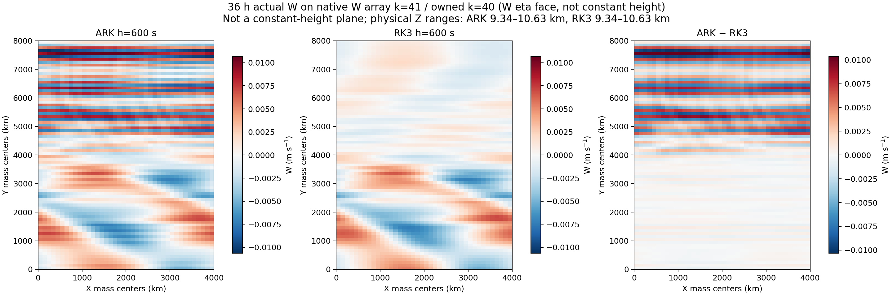
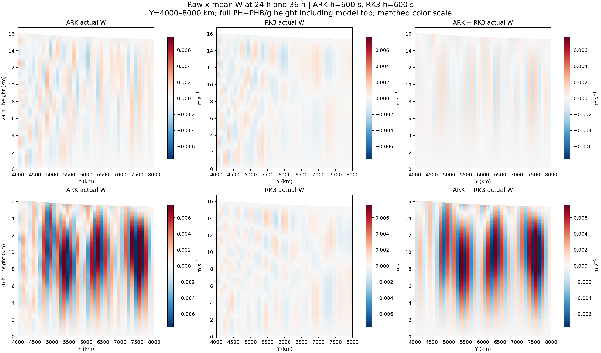
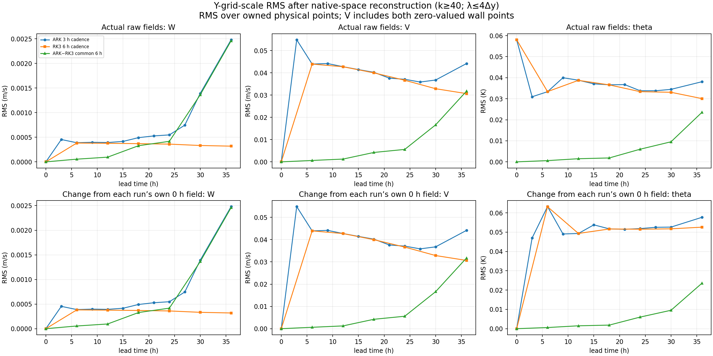
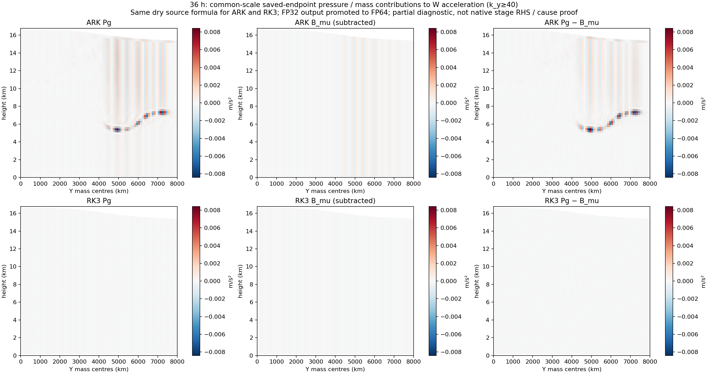
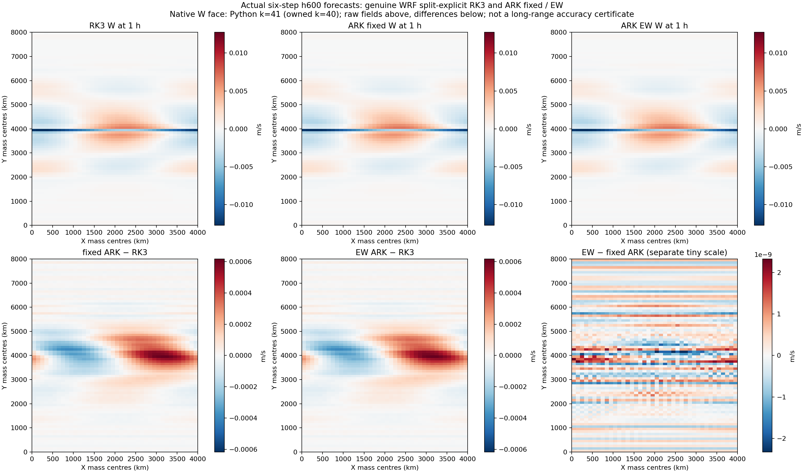

# RK3–ARK 실제장 비교, 잡음 위치와 EW 선별

작성 시각: 2026-10-28T23:31:07.185965+09:00 (Asia/Tokyo)

기준은 main8dc34517336c901a5ec70bc990c5d0d87995e842다. 기존 split-explicit RK3와 채택 ARK324의 같은초기장·100km·600초 사례를 사용했다. 36시간 그림은 보존된 이전 ARK600 실행과 보존 RK3h600이며 새 EW 궤적이 아니다. 별도로 실제6스텝 EW 대조를 수행했다. 생산 C++/Fortran·기본값·방정식·감쇠·시간간격 변경은 없다.

## 실제 원장에서 확인한 위치

이 수평면은 W의 Python 수직index41(owned40,Fortran1-based42)인 eta면으로, 상수고도면이 아니다. 물리높이는약9.34–10.63km다. ARK에Y약4,800–7,800km의X방향으로긴남북교대줄무늬가 보이고 RK3는 훨씬 약하다. 남부의큰규모파동과 북부의격자무늬를 분리해서 볼 수 있다. 같은색범위로 원장·차이장을 나란히 그렸다.

주된 과잉W구조는 북부내부·중상층(대략Y4.8–7.8Mm,Z7–16km)에서24→36시간 커진다. 북쪽벽의몇행만으로설명되는형태는 아니다. 최대고파수W점은Y7,550km,Z9.37km다. 해당점고파수진폭0.00968m/s는k>=20탐색분해값이며, 아래정식격자대역k>=40 RMS와다른지표다.

정식대역은Y파장2–4격자(k>=40,최대400km)다. W/온위는DCT-II, V는벽의0값을포함한DST-I역변환을사용한후 물리소유점x/y/z에서RMS를계산했다. 이는질량가중에너지가아니다. W대역RMS는24시간ARK0.000548/RK30.000360,30시간0.001391/0.000332,36시간0.002480/0.000319m/s다. ARK의후반성장은명확하지만 초기3시간조정이ARK에만생겼다고주장하지않는다. V/온위에는양방법공통의고파수성분이상당하므로모두ARK잡음으로분류하지않는다. RK3는정확해가아니다.

## 처방 대상과 아직 확인하지 못한 원인

저장된FP32 P/MU/기하를FP64로승격해 건조pg_buoy_w와같은형식의압력·기둥질량항을복원했다. 같은색범위를사용한부분진단이며 실제native단계RHS/전체W경향이아니다. 고파수Pg−Bmu RMS는36시간ARK6.38e-4/RK34.27e-5m/s²다. 이쌍에도줄무늬가있으므로 W–PH빠른계의압력·질량결합을우선조사할근거다. 다른W항·시간증폭도있어원인확정이나불균형결함증명으로읽지않는다.

현재소스에서PH의Y6차advective식은Fortran과일치하며, mode1에서는의심했던legacy평균후차분질량분기가실행되지않는다. 이두경로를근거없이수정하지않는다. kdamp는U/V발산항이고W에직접작용하지않으므로이를키워W를억제하는처방도채택하지않았다.

추가로 실제 C++ calc_p_rho_wrf 식과 입력 ALB/T_INIT/PB를 사용해 저장 압력의 시간 정합성을 확인했다. 1시간 단기 RK3·ARK 모두 같은 시각 상태와의 압력 RMS 차이는 약 0.0054 Pa로 초기 반올림 수준에 머물렀고, 이전 600초 상태를 대입하면 약 0.78–3 Pa로 커졌다. 따라서 한 스텝 전체가 늦은 압력이라는 가설은 지지되지 않는다. C++ Rd=287/Cp=1004.5/Cv=717.5도 Fortran과 같다. 다만 마지막 RHS 단계와 최종 결합 상태의 정확한 일치는 아직 입증하지 않았고, 저장 FP32 자료로 native 단계의 상쇄 오차를 인증할 수는 없다. [압력 시각 대조](evidence/ark600_noise_ew_screen_20261028/short_same_vs_prior_pressure_eos.json).

첫표적은북부중상층의실제native단계Pg/Bmu/slow-W수송과접선의고파수투영이다. 공간보간·균형상쇄가다르면그계약을고치고, 같은상태의항이일치하면ARK fast/slow 시간증폭을분리해판정한다. 임의필터추가나실패를숨기는감쇠변경은하지않았다. 잡음위치는확인했으나 **잡음을해결한수치수정은아직없다**.

## EW 실제6스텝 대조

기존EW설정만사용했다. A는기존고정Krylovtol1e-7, B는adaptiveon/초기eta0.1/단계2·3eta범위[1e-7,0.1]다. 최종Newtonabs1e-9/rel0, h600, 전처리·경계·물리·필터는같다. 단계Krylovoverride를0으로유지해예산30×50cycles와관련게이트는바뀌지않았다. 큰단계CSV/개별JVP출력은없고Newton/단계집계만기록했다.

| 실행 | 총JVP 적용 | Newton 보정행 | RSL 6스텝 합계 |
|---|---:|---:|---:|
| A0 | 1328 | 36 | 326.785초 |
| B0 | 790 | 50 | 203.454초 |
| B1 | 790 | 50 | 219.531초 |
| A1 | 1328 | 36 | 399.854초 |

모두모델종료코드0·6스텝·18개수렴단계를확보했다. 후보최대비선형잔차9.61489e-10으로기준을유지했고총JVP적용은40.5%줄었다. 보정이늘었어도전체호출은감소했다. 호출당시간은여전히대략0.16–0.20초이며정확한선형화재사용은미구현이다. standalone실제stage-policy계약48조건이통과했다.

A0는Root가집계수렴메시지허용항목을빠뜨린호출자때문에rawreceipt가failed다. 원래실패기록과sourcehash를보존하고A0를반복하지않았다. 수치·필드/JVP자격은18개단계/출력/RC0/고정receiptSHA로별도확인하고,새호출자는집계NewtonCONVERGED만추가허용해미실행B0/B1/A1을진행했다. 중간공백과기준실행간시간변동때문에 RSL단계중앙값39.9%감소/6스텝합계중앙값41.8%감소는**예비관측**이며정식속도합격이아니다.

또한사전선언한값별8*FP32eps*max(abs(A),abs(B),1)선별에서각쌍617개값(T19/MU568/PH30)이벗어났다. 최대차이는T3.05e-5K,MU7.63e-6Pa,PH4.88e-4m²/s²,W8.25e-9m/s다. 이는저장된섭동값의기계정밀도선별이며실제기상오차예산이아니다. 기준을사후완화하지않았고 **후보채택은보류**했다. 반복A0/A1,B0/B1의14개출력파일SHA는모두같았다.

1시간출력은기존6시간주기RK3archive에없어 보존된RK3실행파일로6스텝참조를한번추가했다. RC0·7개저장상태·초기동일성은통과했지만이전실행파일의12개Fortran디버그줄로quiet검사가실패해필드전용으로한정했다. 원래receipt는보존했고성능표본으로정규화하지않았다. 이1시간그림은36시간잡음해결의증거가아니다.

[EW전체분석](evidence/ark600_noise_ew_screen_20261028/ew_analysis.json), [사전규약](evidence/ark600_noise_ew_screen_20261028/ew_protocol.json), [그림과자료해시](evidence/ark600_noise_ew_screen_20261028/artifact_manifest.json).

Green/Red 최종 검토를 완료했으며, 자료 범위와 미채택 판정을 확인했다. 새5일실행·ARK300/150·전체수반재검증은수행하지않았다. 기존작은수반·쌍둥이·순열완료는유지한다.

Graphify는 현재8dc 소스의Newton/정책/설정/호출자9개코퍼스, 실제실행Python진입점5개, 그림생성6개코퍼스를해시와연결했다. Fortran관계·동적Tensor분기는직접소스추적으로확인했고 그래프를수치정확성증명으로사용하지않았다. 다른리비전의탐색노트는배제했다.
