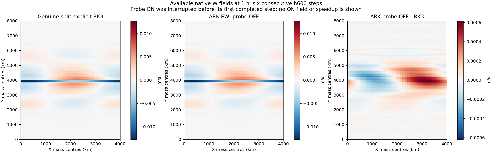

# Bounded estimate-triggered true-residual confirmation

Report created: 2026-10-30 00:55:44 JST (UTC+09:00).

## Scope

PR #325 showed that EW forcing reduced JVP applications, but its candidate
failed the predeclared native-field reproducibility screen. That non-adoption
remains unchanged. This change isolates a different question: can an already
adequate linear solve be recognized before its next scheduled residual check?

The new `sdirk3_gmres_estimate_probe` control defaults off. Both comparison arms
use the same EW configuration; only this control differs. The standard dry
`em_b_wave` grid, 600 s step, physics, filters, preconditioner, restart budget,
and final Newton criteria (absolute 1e-9, relative zero) remain fixed.

## Numerical contract

The Givens estimate is `abs(s[j+1])/||D^-1 b||`, in the same coordinates as the
internal true-residual check. It can request a confirmation, never declare
success. A new early exit requires the explicit `r = b-A(x_trial)` to satisfy
both the existing weighted internal condition and the final unweighted
true-residual condition. The checked trial state and its residual are retained
together; FGMRES uses its stored preconditioned directions without reapplying
the variable preconditioner.

Each restart permits at most one estimate-qualified confirmation. A coincident
scheduled check consumes that allowance without adding a second check. A failed
extra confirmation does not become a new stagnation sample. Existing periodic,
mid-budget, final, and breakdown checks remain in place. Tiny/nonfinite active
Hessenberg diagonals cannot authorize this additional early exit.

Registry, Fortran initialization, C++ namelist/environment parsing, runtime
setter, and effective configuration reporting expose the same default-off
boolean. No EW, tolerance, restart, JVP selection, or damping default changes.
The implementation and strengthened tests are fixed at
`d07db8c5ba911a900259c0e4ad5b109b8d39db25`.

## Checklist and evidence

- [x] Inspect affected callers and update the affected Graphify corpus. Eight
  C++ sources/headers produce 252 nodes and 616 edges, with exact source hashes.
  Registry/Fortran wiring and incoming Newton dispatch are manually inspected;
  extracted edges are navigation aids, not numerical proof.
- [x] Green and Red source review using GPT-6.1-Terra; no production blocker
  identified.
- [x] Initial clean standalone build and three focused contracts pass.
- [x] Recompile and pass the strengthened weighted fixture, which explicitly exercises
  FGMRES with a nonempty preconditioner and counts rejected-trial operator calls.
- [x] Finish the clean native rebuild required by the configuration layout and
  Registry changes. No old objects or generated modules are transplanted.
- [x] Attempt the predeclared block once, without retry. A0 completed; B0 hit
  the disk reserve, so B1/A1 were not launched and the block remains failed.
- [x] Compare OFF with the retained prior EW output and plot available actual
  RK3/OFF fields. ON has no completed forecast and is deliberately absent.
- [ ] Complete the ON/OFF numerical and performance screen. Resource interruption
  leaves this unassessed; no adoption or native speedup is claimed.

Evidence root:
`/Users/yhlee/AD-SDIRK3-review-evidence/early-residual-probe-20261030`.
The initial archive-based build omitted the MYNN-EDMF gitlink contents and
stopped before producing a native binary. The isolated tree was populated from
the exact pinned commit `90f36c25259ec1960b24325f5b29ac7c5adeac73` and the regular
build resumed; the failed log is retained. SDK linkage failures in auxiliary
`test_io_idx`/`diffwrf` tools are recorded separately from the model executable.
The study freezes a 900 s cap per case, 3600 s total, sampled process-tree RSS
4 GiB, study size 5 GiB, and free-space reserve 5 GiB. Preflight verifies source
scripts, executable, all four inputs/namelists, and archived RK3 provenance
before writing the one-shot block receipt. Its aggregate convergence-message
whitelist is fixed before execution. The original PR #325 receipts are intact.

The seven archived genuine RK3 history files match the hashes in the committed
PR #325 analysis. They are reused as a field-only comparator; no new RK3 run is
needed.

## Native result: incomplete comparison, OFF parity established

The clean rebuilt `wrf.exe` SHA-256 is
`bd9b64fa2e615247dc23ebaf9c9056c4e99cd5e67e7d8978f9c7cc64434d02af`.
All eight changed files match source commit `d07db8c5`. The build receipt records
Apple clang 21, GNU Fortran 15.2, Open MPI 5.0.9, Torch 2.10, and netCDF 4.9.3.
Both model executables linked successfully; the auxiliary SDK-link failures
noted above were not normalized into successes.

The block started at 2026-10-30 01:24:28 JST and stopped at 01:30:01 JST.

| Case | Effective probe | Completed steps | Model exit | Result |
|---|---|---:|---:|---|
| A0 | OFF | 6 | 0 | 18 converged stages, 50 Newton corrections, 790 selected AD JVP applications |
| B0 | ON | 0 | 1 after controller TERM | Disk reserve stop; one stage converged before interruption |
| B1 | ON | — | — | Not launched |
| A1 | OFF | — | — | Not launched |

A0's final scaled Newton residuals span `1.31905e-13`–`9.61489e-10`.
Its RSL main-step sum is 299.64122 s; this single control is not an ON/OFF cost
comparison. B0 passed the same initialization gate and its first completed
implicit stage reached `3.62226e-12`, but it completed no outer step. Its model
exit 1 followed the controller's resource stop, rather than establishing a
numerical or MPI termination defect. The controller itself returned 2.
Selected AD/FD counters describe the outer JVP selection, not an independent
audit of every internal fallback.

The OFF trajectory matches the retained PR #325 EW B0 trajectory: all seven
files have identical SHA-256, and all 1,218 numeric arrays compare byte-for-byte.
The retained old receipt matches its committed archive pin; the comparison
records the current hashes of both sets of retained history files. This is a
regression result, not a new physical-accuracy acceptance or a timing comparison
against the old execution.

During B0, free-volume samples fell from 10,147,401,728 to 5,597,405,184 bytes;
the following reserve check stopped below 5 GiB. The study's regular files were
only about 34 MiB at measurement. The source of the volume-wide reduction is
unresolved. No reserve was lowered, no unrelated files/processes were removed,
and no failed case was retried. `cost_eligible=false`, the block status remains
failed, and the predeclared ON/OFF field and time conditions are unassessed.

Available native W at one hour, Python native face `k=41` (owned `k=40`):

The two raw fields use one color range; their difference uses its own scale.
These are actual forecasts, not error-only synthetic panels. The matching
[physical-space W high-band curves](evidence/early_true_residual_probe_20261030/available_w_band_1h.png)
use DCT-II Y modes `k>=40`, reconstructed onto all owned points before RMS.
Neither figure contains an ON forecast or establishes a cure for the later
noise. The existing
[24/36 h actual RK3/ARK W comparison](evidence/ark600_noise_ew_screen_20261028/actual_w_yz_24_36h.png)
and its unresolved northern mid/upper-level growth remain in scope.

The [evidence index](evidence/early_true_residual_probe_20261030/README.md)
contains the build, test, source, protocol, receipt and partial-analysis pins.
Final Green and Red reviews independently verified the 16 public artifact pins,
70 ZIP payload pins and CRC. Green also rehashed all seven retained history-file
pairs; these reviews did not rerun the model or convert the interrupted block
into a passing comparison.

## Remaining scope

This short screen cannot establish five-day accuracy, cure the 24–36 h W noise,
or establish equal-accuracy RK3 speedup. The existing RK3/ARK noise figures and
the PR #325 failure remain authoritative within their stated scopes. Exact
Newton-point JVP reuse and same-state native tendency comparisons remain
separate work; no pressure derivative, transport term, or damping is changed.
