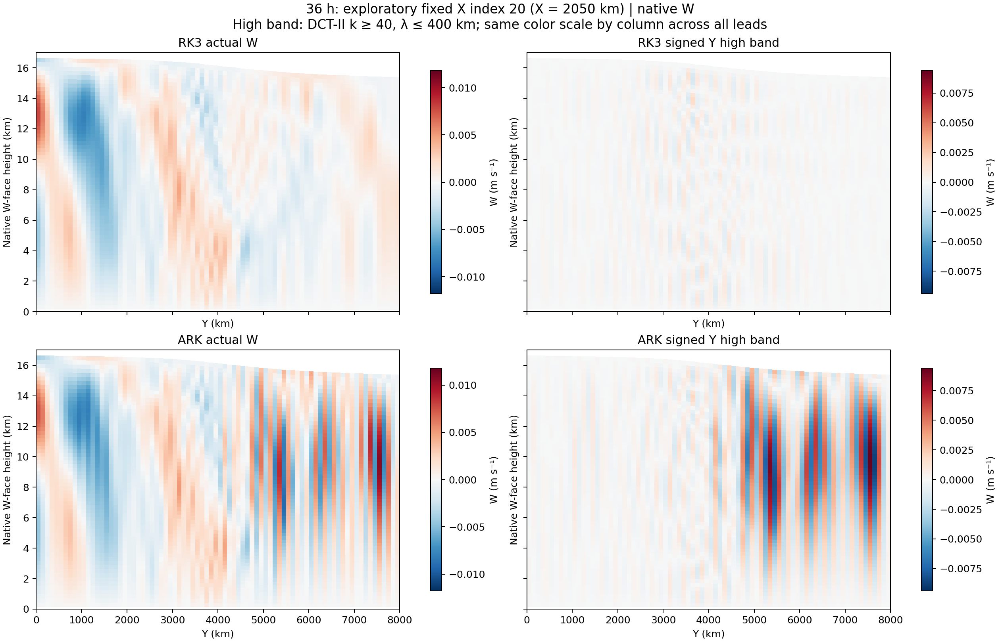
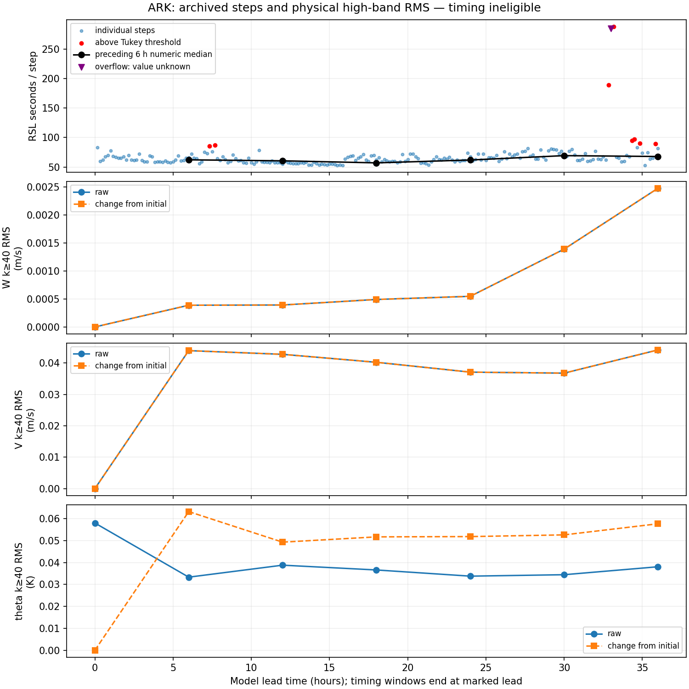
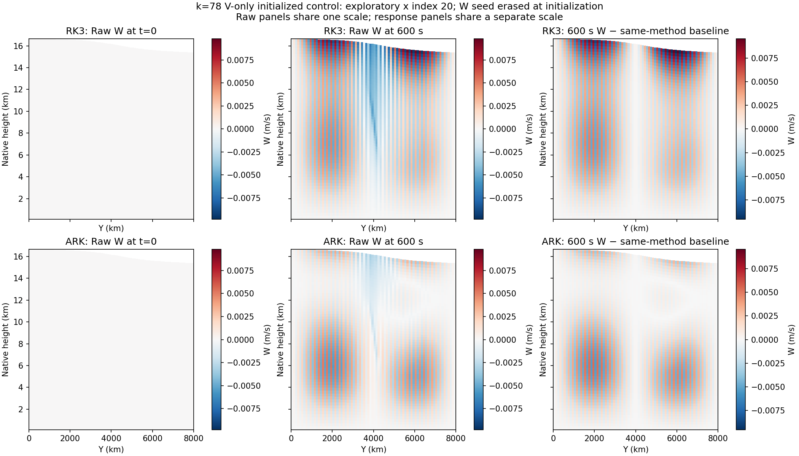

# Noise structure and a transport-invariant IMEX split candidate

Report created: 2026-10-31 12:48:50 JST (UTC+09:00).

This is a structural numerical candidate, not a damping/tolerance adjustment.
The initial reaction-only candidate was rejected by an independent producer-face
contract; it is not a production fix. The replacement below is an opt-in
whole-transport split. Native forecast validation and late-noise/cost improvement
remain open. Source is frozen before fresh component build and short validation.
All new sub-agents use GPT-6.1-Terra with medium reasoning, recorded in AGENTS.md.

## Actual morphology before prescribing a change

These are retained native `em_b_wave` fields at h=600 s, 100 km, not synthetic
error maps. At exploratory fixed X index 20 (2050 km), the ARK northern interior
has narrow alternating-Y bands by 30 h, strong by 36 h, over roughly 3–15 km,
stronger around 7–13 km. Matched RK3 fields are much weaker in this band. Each
run's PH+PHB gives native W-face height; raw and reconstructed k>=40 panels have
separate, fixed shared scales across 24/30/36 h. The band is a locator for about
2–4 grid lengths, not proof of a numerical error or mass-weighted energy.
[24 h](evidence/noise_structure_20261031/w_slice_24h.png) and
[30 h](evidence/noise_structure_20261031/w_slice_30h.png) retain the same scales.

## Cost linkage: observations and controlled native response

The old interrupted run is timing-ineligible. Its preceding-6-hour numeric
medians at 6/12/18/24/30/36 h are 62.28/60.60/57.14/61.97/69.37/67.92 s per step.
The 30–36 h value uses 35 numeric values: the 33 h `**********` time is an
unknown overflow, not a deleted step; no valid window mean or cost decrease is
inferred. Quiet logs contain no per-step Newton/Krylov/JVP work counts. Cost was
already large before the late high-band growth; these times alone do not prove
that noise caused the runtime or support an ARK/RK3 speed ratio.

A separate six-case one-step native diagnostic used the unchanged executable
`bd9b64fa…434d02af`, standard h=600 s, genuine Fortran RK3 (scheme 0/rk_ord 3)
and ARK (scheme 6), fixed Krylov 1e-7 and Newton 1e-9/0. Low k=2 and high k=78
inputs had equal intended V/W RMS; k=78 was selected before launch from the
retained spectrum, not from favorable work counts. Every case exited 0 and
completed one step; no retry occurred. Active scoped idle-sleep inhibition and
open-lid preflight gave maximum wall/monotonic discrepancy below 0.003 s.

**The intended combined V/W initialization failed its declared gate:** W was
reset to zero by initialization in both methods. V retained 0.04 m/s RMS in all
perturbed cases, with other checked fields equal and paired initial states
matched. The original gate remains failed. The following are descriptive
V-seeded observations, not a passed combined-mode or historical-state test.

| ARK initialized case | Newton corrections | Arnoldi iterations | Selected JVP | One-step RSL (s) |
|---|---:|---:|---:|---:|
| Baseline | 6 | 216 | 240 | 98.38298 |
| Low k=2 V seed | 6 | 216 | 240 | 93.28040 |
| High k=78 V seed | 10 | 291 | 322 | 147.16833 |

The high-wavenumber V-seeded case has 34.17% more JVP applications and more
Newton work. This is evidence of mode-dependent solve burden in this controlled
initial background, not proof of the cause of the 36 h forecast pattern.
Selected AD counters do not certify every internal fallback.

For high k, baseline-subtracted generated W RMS is 0.00205012 m/s (RK3) and
0.00151885 m/s (ARK); initialized W is zero, so W gain is undefined. V component
RMS gains are 0.786708 and 0.651528. These component responses do not support a
blanket claim that ARK simply damps all high modes too weakly, and are not total
energy or eigenmode-stability evidence. A single observation is not a robust
benchmark or a same-accuracy speedup test.

## Mathematical operator findings

Source and effective-log audits show horizontal pressure gradient, mass
continuity and diagnosed current-state Omega in the implicit RHS; a frozen-Omega
or wholly explicit-horizontal-acoustic explanation is unsupported. Damping is
added after conversion to physical U/V accelerations. Its local velocity
`grad(div)` operator implies m²/s coefficient units; it is not the same operator
as RK3 pressure-history smdiv, column-mass-tendency emdiv or acoustic epssm.
The old run's exact damping value was inferred, not fully logged. No arbitrary
mass factor or larger coefficient has been inserted.

The finite C-grid identity G=−Dᵀ gives a positive pressure Schur block
`S=I+a²c²DDᵀ`, where a=h*gamma. It has no checkerboard-null mode. The separate
[constant-coefficient derivation](evidence/noise_structure_20261031/schur_derivation.md)
explains a principled horizontal preconditioning direction, not a demonstrated
WRF speedup; actual variable coefficients and boundary maps are still needed.

More concretely, an actual compiled production-RHS manufactured-state probe
found Full U tendency zero, but opposite Fast/Slow U maxima
1.46410151501e-4 m/s². For constant physical theta=310 K, stored t=10 K, Fast and
Slow temperature tendencies are opposite 7.32050758e-5 K/s. Full−Fast−Slow is
zero. The mass product-rule correction is applied with fast continuity, while
its cancelling conservative advection is slow. Each partition therefore lacks
the constant-transported-component invariant. This does not by itself establish
the cause or magnitude of the late forecast noise.

The scalar is theta−300, not full theta: fast pressure compression does **not**
vanish. Its simplified coefficient retains 300/theta of the conventional term.
The contrary full-cancellation hypothesis was tested and rejected; it is not a
basis for the proposed change.

## Rejected precursor and replacement candidate

The earlier patch moved only the mass product-rule conversion to Slow while
continuity remained Fast. An independent producer-face reconstruction failed
(errors about 633 in that fixture), showing that matching constant-component
invariants alone was insufficient. The candidate was rejected; its failed CI and
native-controller failure receipts remain. No tolerance was relaxed to accept it.

The replacement is explicit opt-in `imex_split_mode=4`. Legacy mode 3 is restored.
Mode 4 uses the same ARK324 tableau and places the existing conservative U/V/W/t
transport together with continuity in Fast. Slow retains its nontransport terms.
The original product-rule conversion follows that same continuity. Full RHS,
spatial stencils, coefficients, timestep and nonlinear tolerances are unchanged.
This is a changed IMEX partition, not proof that the 36-hour noise is fixed.

Its supported scope is forward-only, single-rank whole-tile WRFParity, periodic X
and symmetric Y, current diagnosed Omega, no HEVI/split-explicit/AD halo or
retained adjoint. Internal FP64 integration/state carry are not enabled for mode
4; unsupported split FullHalo calls fail explicitly. The archived modal and noisy
mode-3 forecasts used internal FP64 with carry. Therefore a mode-4 FP32 probe
must be paired with mode-3 FP32 using the same executable, and cannot be called
an otherwise identical comparison against those archived forecasts.

The raw vertical principal preconditioner is selected for exact modes {3,4}
with its other guards unchanged. Its EOS/geopotential/temperature coefficients
and ARK gamma are shared. Added transport Jacobian couplings are omitted from
this approximation and are not claimed to be small. Actual-operator FGMRES
and independent true-residual checks remain required.

Two focused tests reuse the existing RHS-preconditioner executable: pointwise
Full=Fast+Slow, bit-identical mode-3/mode-4 Full RHS, nonzero Fast/zero Slow mass,
constant transported-component invariants, actual theta producer faces and
boundary closure, forward AD versus centered FD, and observation noninterference.
A nonuniform actual mode-4 operator with the raw principal model must converge
within the existing 16-iteration test budget at true relative residual 1e-5.
These manufactured cases are operator checks, not practical timestep validation.
The actual native comparison remains h=600 s, with fewer steps, not smaller h.

Status: replacement source reviewed and frozen; build, focused tests and paired
native short-run checks are pending. Native noise suppression, runtime improvement,
5-day stability and physical accuracy acceptance are not established. Earlier
completed twin/adjoint results remain tied to their original source and scope.

Latest replacement update: 2026-10-31T15:14:45.173262+09:00.
