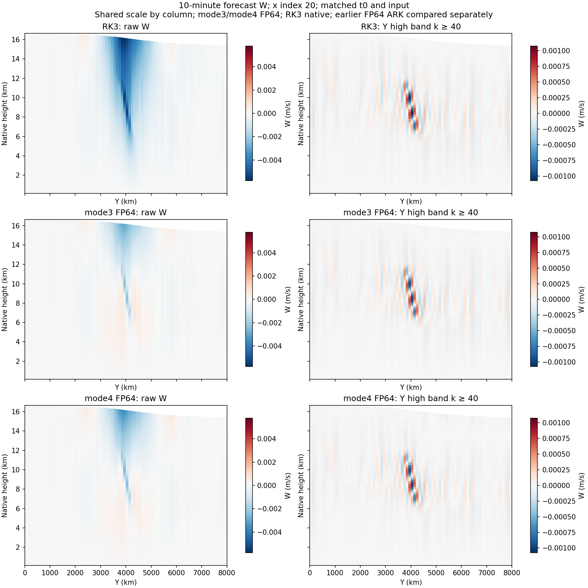

# Conservative implicit transport: short native comparison

Local timestamp: 2026-10-31T15:46:18.517878+09:00.
Production code/executable: dc2810585f8f8abc98865ece9c2a90414fd40d2b;
SHA-256 de5df2b4c97f79eebfd25eb6641228315f9e02321a5ed64a79dd78666c7199a7.
Sub-agents: GPT-6.1-Terra, medium, Green/Red source and evidence review.

## Outcome and scope

Both ARK partitions completed one native 600 s step at the official-sized
40x80x64, 100 km em_b_wave setup, using identical inputs, internal FP64/carry,
strict Newton 1e-9/0 and fixed Krylov 1e-7. Namelists differ only in mode 3/4.
The original mode-3 end file is byte-identical to the earlier native FP64
baseline. The genuine split-explicit RK3 reference is reused at the same
600 s timestep with matched post-initialization fields. This is 10 minutes,
not evidence of a 36 h noise repair, 5-day stability or accuracy acceptance.

Fixed X index 20; each method uses its native PH+PHB height. All three rows
share each column's color limits. Right panels reconstruct DCT-II Y modes
k>=40 in physical space, not coefficient RMS or mass-weighted energy.
The earlier 24/30/36 h northern alternating-Y structure remains documented in
[the morphology report]((202610311248)_noise_structure_and_physical_split_candidate.md).
This first-step plot does not establish suppression of that later structure.

| Quantity | Legacy mode 3 | Whole-transport mode 4 |
|---|---:|---:|
| Completed steps / return code | 1 / 0 | 1 / 0 |
| Newton corrections | 6 | 5 |
| Selected JVP / Arnoldi iterations | 240 / 216 | 192 / 173 |
| RSL integration seconds | 67.17513 | 123.86571 |
| W RMS distance to RK3 (m/s) | 0.000690994 | 0.000686364 |

JVP applications fell 20%, but the observed single-step time increased.
Adding full transport to every implicit JVP costs work; this pair is not a
robust timing experiment and does not isolate kernel timing causality.
No speedup or noise-fix adoption claim is made. Mode 4 remains opt-in and draft.
All reported Newton stage residuals meet the original 1e-9 scaled-RMS criterion;
mode-4 stage 3 is 8.963654e-10. Selected AD/FD counters are not a proof against
all internal fallback. Six physical-unit field comparisons are in the CSV.

## Mathematical and engineering checks

Mode 4 keeps the existing conservative momentum/scalar fluxes with continuity
in Fast, restores the per-partition product rule, leaves Full RHS and the ARK
coefficient table unchanged, and preserves legacy mode 3. Actual producer-face
closure, Full3/4 bit equality, FWAD/FD and nonuniform actual-A4/preconditioner
FGMRES checks passed against the rebuilt native archive; true relative residual
was 1.83613e-16 in the manufactured fixture. This is not a full-domain error bound.

The first face-test failure was an oracle mistake: FP64 division by grid spacing
was compared with production's imported FP32 reciprocal. The max error
1.55342535279601e-7 was accounted for by 1.55342535157398e-7 from that difference;
using the imported coefficient gave exactly zero. The original 1e-8 bound was
retained. No production equation or tolerance was changed for this correction.

A full duplicated mode-4 refinement ladder timed out at 180 s locally and in
CI; it is preserved as incomplete. The mode-4 capability test now checks two-
and four-step isolated-vs-owned FP64 carry, exact FP32 publication, real sub-FP32
state information and unchanged state/coefficient/timestep tamper guards.
It passed in 33.35 s under the unchanged 180 s limit. Legacy mode-3 refinement
checks remain unchanged. Mode-4 temporal order is not established by this test.

The prior FP32 native control reached its 240 s deadline before completing a
stage; the candidate was skipped. Its failure receipt is retained, unused output
removed, and no retry or precision-mixed speed ratio was constructed. The new
precision-matched pair had wall/monotonic discrepancies below 0.002 s, but one
sample per mode remains diagnostic only. Space was checked only before/after;
outputs were t0/end, with aggregate solver records and no per-JVP dumps.

## Remaining work and decision

The whole-transport candidate passes these bounded correctness checks, but it
has not demonstrated a runtime improvement or late-noise repair. Do not enable
it by default or start a 5-day run on that basis. A cheaper reference-transport
split is only a written design hypothesis: it requires a common fixed reference,
correct stagger/face conservation and an ARK order argument; the existing stage
reference is overwritten between Fast and Slow and cannot simply be reused.
No such replacement has been implemented. Same-state native term analysis and
short controlled mode growth must establish the late-noise mechanism before
prescribing damping changes or a long run.

Build provenance, failures, completed run receipts, physical metrics, plot slices
and hashes are in [the compact evidence manifest](evidence/implicit_transport_short_20261031/manifest.json).
Full valid native fields remain in the local evidence directory. No large raw
model output or executable is added to the repository. Latest CI for the scoped
handoff source is pending; the previous nine other selected tests passed and
the only previous failure was the duplicated mode-4 ladder timeout.
