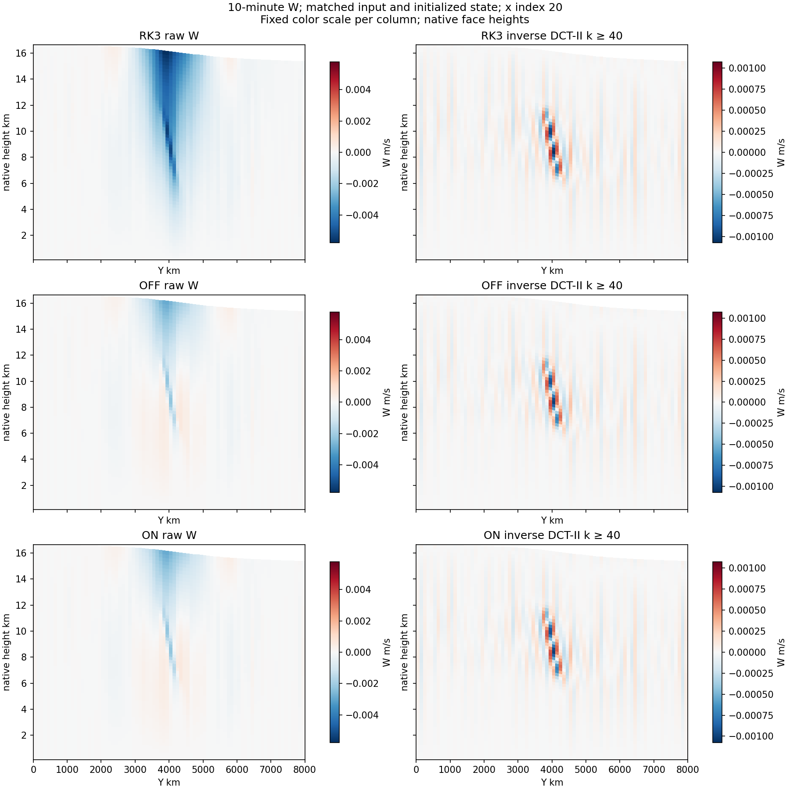

# Newton-local exact JVP: completed native screen and scope closure

Local timestamp: 2026-10-31T18:54:20.144027+09:00.
Production source: be66161fa03b50d5b0006b5faec016135517d6da.
Executable SHA-256: ce3b78a41ddbac8942fed8debf3d045ef51cd07d7ed53b5d52611a293bee72e6.

The full clean Fortran+C++ build finished. The new Registry layout, new implicit
Fortran object,24 C++ archive members, links and unchanged baseline artifacts
were verified. Three auxiliary links (test_io_idx and two diffwrf) had the known
System-library error; the main WRF and ideal executables linked. Fresh native
C++ component checks and be661 Linux CI passed. Component tests alone do not
certify the Fortran bridge; the two completed WRF cases below exercise it.

| One600s step, same40x80x64/c3 input/FP64 carry/mode3 | OFF | ON |
|---|---:|---:|
| Return code / completed steps | 0 / 1 | 0 / 1 |
| RSL main integration seconds | 80.34693 | 57.18931 |
| Wall seconds | 82.14084 | 58.18085 |
| Rank high-water RSS bytes | 2050408448 | 2117500928 |
| Selected matvec JVP calls | 240 | 240 |

Observed RSL reduction: 28.82%. This is a screening observation, one
ordered sample per setting, not a robust speedup or equal-accuracy RK3 win.
The ON case includes preparation/reference-validation overhead:6 preparations,
6 direct dual references,6 prepared validation applications and240 prepared
matvec applications. All6 reuse records were enabled without fallback;
preparation/validation time totaled3.045254s, Krylov scopes51.04016s.
Both cases met the unchanged1e-9 scaled-RMS Newton criterion at stages2/3/4.
Largest ON reported scaled RMS was6.382414e-14.

OFF matches the archived endpoint across all174 numeric arrays bit-for-bit.
ON passed the preregistered8eps owned-field screen: U/PH/T/MU differences zero,
V maximum2.3283064e-10m/s and W maximum5.8207661e-11m/s. The new Registry history
attribute may change file bytes, so native-array parity is the comparison.
Both initial states match the genuine archived RK3 input and initial-state gate.

Raw and reconstructed short-Y W use common color limits and each native PH+PHB
height. This backend changes no PDE/split/filter and is not a noise treatment.
The10-minute plot does not establish suppression of the old24–36h bands.
RSS is postrun rank high-water only, excludes launcher and is not a live cap;
both values are below the registered4GiB acceptance bound. Wall/monotonic
absolute gaps were below0.002s. Actual backend thread count was not independently
sampled; pinned environment and Fortran-configured thread setting are retained.

## Direction changed before expanding the experiment

The user supplied the pressure-Schur structural design while this short pair
was running, then requested a finite checklist. Therefore the conditional
six-step A-B-B-A reuse-only expansion is **not started**, and no5-day run is
started. It is not marked passed or erased. The measured reuse implementation
remains default-off and a bounded oracle/cost candidate. Primary development
moves to pressure Schur preconditioning on the original600s native linear stage,
then a structured fast operator; it does not add mode5 or change physical
coordinates/time integration at the same time.

Full valid fields, failure simulations, compiler logs and exhaustive1270-object
provenance remain in the local evidence directory. Compact public evidence is
in [the manifest](evidence/newton_local_reuse_20261031/manifest.json). Green/Red
review is required before promoting beyond this completed screen. The practical
cost gap and late-noise cause remain open.
