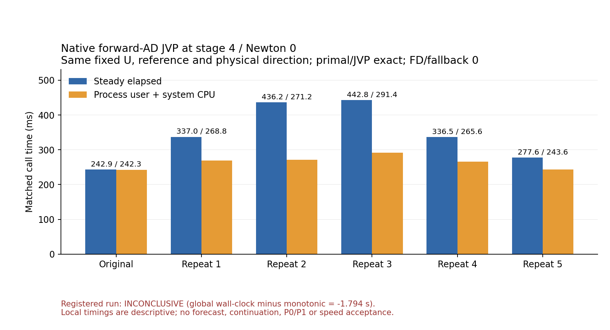

# 종료형 native JVP 반복 — 값 일치, 비용 변동, 원래 실행 판정 INCONCLUSIVE

작성: 2026-11-02T00:42:48.739455+09:00.
기반 main036748f2; 실제 실행 소스 `08b21c1117bf52c93ac3bf1793831f4300dcdc56`.
Green·Red: GPT-6.1-Terra, medium.

## 실제 완료 범위

원래 초기장의 표준 em_b_wave 100km·40×80×64·600초·FP64·MPI1rank에서
stage4/Newton0 첫 Arnoldi(ordinal5, timestep0)의 원래 native forward-AD JVP1회와
추가5회를 실행했다. 동일한 RHS wrapper와 실제 U/ref/물리 접선을 사용했다.
원래 dual 평가에서 primal도 받아 별도 RHS 평가를 추가하지 않았다. PreparedJvp는 사용하지 않았다.
진단은 첫4개 선형계와 stage2/3 이후 다섯 번째 선형계의 첫 작용에서 끝났으며,
그 선형계나 대시간스텝을 완료하지 않았다. **완료 스텝0, 예보 완료false, 재시도0**이다.

[실행 전 규약](evidence/terminal_jvp_replay_20261102/registration.json)에 고정한
단일 native 시도만 수행했다. 종료코드86과 명시적 terminal marker/JSON은 일치한다.
C++ 반복 블록의 status는 terminal_diagnostic_passed다. 그러나 실행 전체 벽시계50.272925초와
단조시계52.066713초의 차이가 −1.793788초로 사전 |차이|<1초 조건을 실패했다.
따라서 **원래 runner의 INCONCLUSIVE/errors=[clock_gap]를 그대로 유지하고 cost_eligible=false**다.
표본별 유효 clock 플래그를 전체 실행의 적격 비용 통과로 바꾸지 않는다. 재실행도 하지 않았다.

## 실제 값·비용 표

| 표본 | steady 경과 ms | process user+system CPU ms | primal/JVP |
|---|---:|---:|---|
| 원래 호출 | 242.933292 | 242.342000 | 기준 |
| 반복1 | 336.966125 | 268.797000 | 바이트 일치 |
| 반복2 | 436.160167 | 271.244000 | 바이트 일치 |
| 반복3 | 442.808750 | 291.431000 | 바이트 일치 |
| 반복4 | 336.454833 | 265.616000 | 바이트 일치 |
| 반복5 | 277.561916 | 243.640000 | 바이트 일치 |

추가5회의 primal·JVP 최대 절대차는 모두0이다. 각 호출은 Implicit RHS1회이며
외부FD·내부FWAD→FD fallback은0, 실제 Torch intra/inter-op은1/1이었다.
U/v는 원래 호출 전 capture 및 반복 사이에서 일치하고, ref와 관측 고정 문맥의 지문도 유지됐다.
이것은 해당 상태·한 방향의 값/경로 근거이며 전체 Tile 재생·모든 방향 연산자 동등성이나
원래 적분의 안전한 재개를 증명한 것은 아니다. 작업 버퍼·cache를 복원하지 않고 종료했다.

추가5회만의 CPU 중앙값268.797ms, 범위243.640–291.431ms, 표본 CV6.35%다.
steady 경과 중앙값336.966ms, 범위277.562–442.809ms, 표본 CV19.49%다.
전체6회와 추가5회 통계는 [CSV·요약](evidence/terminal_jvp_replay_20261102/analysis/summary.json)에 구분했다.

원래 표본은 해당 선택점의 첫 호출이며 프로세스의 cold 첫 RHS는 아니다. 입력 해시·출력
비교·복제는 호출 타이머 밖이지만 cache를 준비할 수 있다. 반복 callback의 반환 포장 비용은
반복 호출 타이머에 포함된다. 따라서 cold/warm 일반 성능이나 다른 실행과의 속도비로 쓰지 않는다.
`wall−CPU`는 산술 잔여이며 직접 측정한 대기나 특정 OS·swap·앱·cache 원인이 아니다.

값이 같아도 비용 변동이 남았고 원래 호출이 가장 느리지도 않았다. 첫 호출 준비비용 하나만으로
이번 양상을 설명할 수 없다. 고정된 입력에서의 변동을 후반 W 잡음의 성장이나 P1의 효과로
돌릴 근거도 없다. 잡음이 다른 궤적에서 Krylov 작업량을 늘리는 가능성과는 별도 질문이다.

## 검증 및 기록의 경계

- 공유 inline 헤더를 사용하는 Newton·Tile·pressure-stage probe·V-primary probe 네 TU를
  재빌드했다. 나머지27개의 source/depfile/header/archive member와 Fortran·라이브러리·SDK27.2,
  compiler·로드 문맥을 확인해 같은31-member archive로 링크했다. class/Fortran ABI 변경은 없다.
- macro는 기본OFF인 종료형 연구 빌드이며 새 runtime/namelist 설정은 없다. 선택된 예외도
  Newton/Fortran 실패 처리로 돌아가지 않고87로 끝난다. 일반 CI는 기본OFF 경로를 검사한다.
- 실제FWAD primal 포착1RHS/FD fallback stale-primal 제거와, 비대칭 비선형 제조식의 반복 helper,
  path/fallback/context/input/timing/덮어쓰기 음성시험을 집중 컴파일·실행했다. 이 제조시험을
  native WRF 결과로 세지 않는다. [시험 기록](evidence/terminal_jvp_replay_20261102/helper_tests.json).
- 초기화 후21개 장·계수는 보관 RK3 및 A9 control T0와 수치 일치했다. 새 RK3 적분/시간 비교나
  미래 예측장 비교는 하지 않았다. U/ref/v/Jv의 A9 지문도 일치했으나 새 원배열을 저장하지
  않았으므로 과거 배열과 독립 바이트 대조한 것으로 표현하지 않는다.
- runner의 converged_stages=[]는 rsl.out만 읽은 필드다. rsl.error에서 stage2/3 완료를 확인한
  별도 native_audit를 연결하며 원래 runner/result를 수정하지 않았다. clock 실패는 그대로다.
- 새로운 giant graph/반복별 배열/전역ps·lsof 계측을 추가하지 않았다. 같은 바이트인 초기장과
  세 기존 첫점 진단 파일은 이미 readonly인 A9 원본으로 hardlink해 중복 논리량109201721바이트를
  정리했다. 고유 근거나 원판정은 보존하며 APFS 실제 회수량을 주장하지 않는다.

## 다음 판정

이번 종료형 진단 **구현·단일 실행·결과표 확보는 완료**다. 기존 문맥 경계에 대한 단순 서술을
실제 반복 값/비용 관측으로 옮겼다. 그러나 전체 clock gate를 통과한 재현 가능한 비용 수용이나
동일 A,b,x0,S의 P0/P1 비교는 **미완료**다. 이 실패 시도를 통과로 바꾸거나 자동 retry하지 않는다.
다음 비용 비교는 원래 A의 잔차와 준비 포함 전체 선형계 비용을 판단하는 별도 사전 고정 실험이어야 한다.
6–12스텝·W 잡음·공간 연산자 동등성·5일 정확도·RK3 대비 실용 비용도 계속 미완료다.
