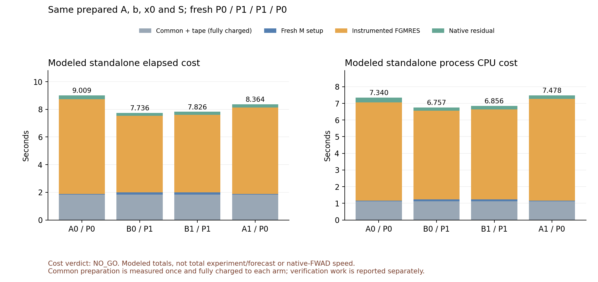

# 공통 prepared A의 P0/P1 비용 비교 — 완료된 NO_GO

작성: 2026-11-02T11:38:39.371739+09:00.
기반 main9292c6c8; 실제 완료 소스 d0bfa40b997a2cf34e2660de2119daf1cfbc8d73.
Green·Red: GPT-6.1-Terra, medium.

## 이번 결과

같은 실제 stage2/Newton0의 b,x0,S에서 **하나의 PreparedJvp 객체가 정의하는 A**를
공유하고 P0–P1–P1–P0 네 군을 비교했다. 기존 선형화 재사용을 두 군 공통으로 켰으므로
native forward-AD 커널 비용이나 과거 감소율과 곱해 해석하는 실험이 아니다.
100km·40×80×64·h600·FP64·MPI1·실제 Torch1/1, 원래 방정식·필터·허용오차를 유지했다.

수정 블록은 diagnostic_completed/종료88, 비용 판정은 **NO_GO**다.
등록된 2배 조건을 낮추거나 P1을 전 단계·B·C로 확대하지 않는다.

| 군 | M | Arnoldi | A 적용 | M 적용 | 준비 포함 모형 경과 s | 모형 CPU s | native scaled 잔차비 |
|---|---|---:|---:|---:|---:|---:|---:|
| A0 | P0 | 21 | 23 | 21 | 9.009019 | 7.340197 | 1.2772678e-09 |
| B0 | P1 | 13 | 14 | 13 | 7.735816 | 6.756989 | 8.2438160e-10 |
| B1 | P1 | 13 | 14 | 13 | 7.825823 | 6.855843 | 8.2438160e-10 |
| A1 | P0 | 21 | 23 | 21 | 8.363737 | 7.478201 | 1.2772678e-09 |

대응쌍 P0/P1 비는 charged 경과1.164586/1.068736, CPU1.086312/1.090778이다.
진단 overhead를 뺀 accounted 경과1.153980/1.056898, CPU1.073741/1.078078이다.
여덟 비교 모두2배에 미달했다. accounted는 무계측 실행을 직접 측정한 값이 아니다.
한 프로세스 안 ABBA이며 독립 예보 네 번의 성능 인증도 아니다.

## 비용의 정의와 구조적 판단

charged = common snapshot/prepare + tape 준비(후보마다 전액) + 새 M 준비 + instrumented solve +
해당 native residual이다. 공통 준비는 실제1회 측정하지만 단독 후보 관점에서 전액 charge했다.
이는 전체 ABBA 실제 경과56.745403초의 분할·합계가 아닌 **명시적인 후보별 모형 비용**이다.
세 native preprobe,27 tape 검증,8 native mixture 검사,경계 지문 시간은 별도 기록하고 제외했다.
검사·복제는 cache를 조건화할 수 있으므로 조용한 실제 전방 실행의 속도로 확대하지 않는다.

A 적용은23→14로39.13% 줄었지만 P1의 wrapped M CPU/호출 가중 평균은 P0보다 약2.60배다.
P1은 각 군13회 M에 내부 Arnoldi52회·X/Z 부분풀이65회·primary78회를 수행했다.
더 적은 외부 반복의 이득이 더 비싼 M과 공통 준비·나머지 작업에 상쇄된다.
같은 준비된 A에서도 호출당 실행비용이 완전히 일정하다는 가정은 하지 않는다.

다른 비용·A 시간·호출 수를 관측값대로 고정하고 **P1의 M 준비와 모든 M wrapper를0원**으로
만드는 가정에서도, charged 경과 속도비 상한은1.6321/1.5029, CPU는1.5723/1.5821이다.
실현 가능한 미래 속도 예측은 아니지만, 현재 호출 수/다른 비용을 그대로 두고 M 변환만
미세 최적화해서2배를 얻을 수 있다는 근거는 없다. 비용의 큰 변화에는 더 적은 A 적용,
낮은 A 적용비용 또는 준비/전체 구조 개선이 필요하다. 이번 P1을 조정하며 확대하지 않는다.

## 수치 확인의 범위

- 공통 tape1개, constructor RHS1회, native15회, tape 검증27회이며 interleave·fallback·guard0이다.
  세 고정 probe의27회 tape/native 검증 최대차3.55e-15를 관측했고, 실제 Arnoldi 조합의
  최대차는 P0 3.69e-13/P1 1.44e-13이었다. global/각 block의
  elementwise allclose(rtol1e-10,atol1e-12) 조건을 통과했다. primal은 torch::equal 수치 일치다
  (signed zero 동등, byte 일치라는 뜻이 아니다).
- 실제 Arnoldi Z/AZ 누적 수21/13/13/21과 솔버 보고 수가 같았다. 두 조합의 |cos|는
  P0약0.216/P1약0.361로 비퇴화였고, tape 파기 후 native 검사도 통과했다.
  이는 검사한 방향들의 근거이며 모든 방향·전체 mutable Tile 동등성의 증명이 아니다.
- 각 해의 원래 native r=b−A(x)는 같은 applied1.0000000116860974e-7보다 작았다.
  physical L2와 block norm은 별도 보고하며, 섞인 단위의 norm을 기상 오차/에너지로 부르지 않는다.
- 두 번역 단위는 현재 헤더로 재빌드하고29개 검증 객체를 재사용해31-member archive로 링크했다.
  Fortran/SDK/컴파일러·라이브러리/입력 해시는 고정했다. ABI·PDE·감쇠·시간간격 변화는 없다.
- 기존 RK3와 두 시도의 초기화 후21개 장/계수는 수치 일치했다. 미래 예측장·새 RK3 적분이나
  시간 비교를 수행하지 않았고, 완료 단계/시간스텝0인 종료형 진단이다.

## 첫 실패와 실행기 보완

총 native 시도는 **서로 다른 등록 소스 블록에서 각각1회, 총2회**다.
첫11b71a6b는 old selected_base 캡처 생략 정책 때문에 V-primary 콜백이 비어 input에서
종료89였다. native0/M0/풀이0이며 INCONCLUSIVE를 유지한다. 초기화된0 시간값은 측정값이 아니다.
수정은 Stage2의 active base 캡처를 허용하고 기존 Stage4 생략을 보존한 진단 연결이다.
원래 failed/duplicate 검사, 식·입력·판정 조건은 유지하고 별도 소스/등록으로1회 확인했다.
실패 기록을 덮어쓰거나 같은 바이너리를 유리할 때까지 재시도하지 않았다.

새 clock endpoint는 monotonic-before/realtime/monotonic-after를 모두 보존한다.
완료 블록의 읽기 span은1750/1083ns, gap interval은[489208,496209]ns로 consistent였다.
이는 이번 규약의 유효성일 뿐 과거 #337의 −1.794초 원인을 소급 결정하지 않는다.
시계 읽기 사이1.794초 지연의 합성 시험은 unresolved로 분류하며 실제 시계 변경과 구분했다.
수렴 집계는 stdout/stderr를 함께 읽는다. 과거 #337은2/3단계 완료를 독립 재집계했으나
원래 결과 파일의 []와 INCONCLUSIVE는 보존했다. 이번 terminal은 모두0단계/0스텝이다.

## 완료·미완료

이번 범위의 동일 공통 prepared A·b·x0·S, 준비 포함 모형 비용 비교와 **P1 확대 NO_GO 결정은 완료**다.
기존 A4 NO_GO, A8 제한 선별, A9 관측, A10 원래 INCONCLUSIVE는 바꾸지 않는다.
PreparedJvp 자체의 실용 전방 성능, native-FWAD 경로의 지연 원인, W 잡음·공간 연산자 정합성,
6–12스텝·5일 정확도·RK3 대비 합리적인 전체 비용은 계속 미완료다. 이번 자료로 생산 채택하지 않는다.
