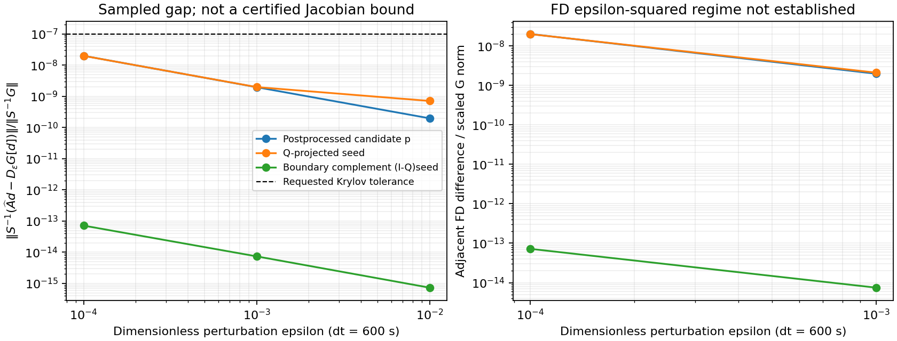

# O1 표현 정정과 실제 방향의 O2/O3 제한 검증

작성: 2026-11-03T08:42:23.533243+09:00.
기준 main `b98a0e81df0e3ca7fc59499d9246aa42f03038ab`(PR341).
최초 진단 소스85df4680, scope 수정 소스acc39391. Green·Red: GPT-6.1-Terra medium.

## 이번 체크리스트

| 항목 | 처리·근거 | 상태 |
|---|---|---|
| O1 고정/갱신 reference | 고정 C와 C(Y), projection 이전 reference 복사, DC chain 항 분리 | 정의 정정 완료 |
| O1 exact/selected operator | A*와 선택 JVP의 Ahat 및 공통 norm의 gap 부등식 분리 | 정의 정정 완료 |
| O2 실제 경로 | mode3·single tile·FP64·AD·reference/reuse off·H=I의 관측 입력과 소스 역할 확인 | 제한된 관측; 전체 cache 고정성은 미입증 |
| O3 선택점·방향 | 실제 후처리 후보, Q seed, 경계 complement와 세 epsilon 측정 | 9개 sampled 결과 확보; 엄밀한 gap 상계는 미입증 |
| 기존 링크·회귀·종료 문구 | PR341의 원래 완료 범위 보존 | 재시험하지 않음 |

## 정의와 측정 대상

[O1 계약](design/mode3_residual_operator_contract.md)은 고정 C에서 F_C(Y)=Qf(QY;C),
갱신 C(Y)에서 F(Y)=Qf(QY;C(Y))를 구분한다. 후자의 미분에는 D_C f·DC가 필요하다.
A*=DG_K와 Ahat(v)=v−J_selected(Y,av;C_call)를 동일 기호로 두지 않는다.
O2는 실제 호출의 문맥과 함수 성립 조건, O3는 미분 일치 또는 gap을 다룬다.

실제 진단은 같은 compute_rhs wrapper의 G_K=K−F(B+aK), a=600γ를 사용한다.
K±εd에서 B+a(K±εd)를 구성한다. ε=0.01,0.001,0.0001은 **방향 섭동의 무차원 크기**다.
시간간격을 줄인 비교가 아니다. 선택 JVP는 production apply_jacobian(d)를 그대로 사용한다.
입력 GradMode/requires_grad를 바꾸거나 상태 의존 물리를 detach/freeze하지 않았다.
재사용될 수 있는 출력만 복제해 차분 비교를 보호했다. EOS 캡처는 native Q callable의
출처 확인에 쓰며, FD/JVP의 물리계수를 frozen EOS로 대체하지 않는다.

방향은 후처리된 탐색 후보p, 실제 Q가 투영한 deterministic seed, (I−Q)seed다.
후자의 방향은 의도적으로 Q 제약 complement이며 물리적으로 허용된 방향이라고 부르지 않는다.
seed 두 방향은 p와 같은 S-norm으로 정규화했다. p는 변경하지 않았다. trust/recovery나
수용된 갱신 전에 종료하므로 p를 최종 수용 update라고 하지 않는다.

## 원래 실패와 별도 수정 실행

첫 등록85df 실행은 legacy A9 관측기의 ordinal5 검사에 stage2/ordinal1을 넘겨 invalid가
되어 측정 전에 INCONCLUSIVE로 끝났다. 원 결과·로그·판정은 보존했다. 이는 JVP 불일치나
수치 발산이 아니다. A9 판정 조건을 낮추지 않고 O3에서 그 보고기만 호출하지 않게 했으며,
자체 ordinal1·reference 동일성·경로 검사를 유지/강화했다. A9 raw-NPY 적격성 검사는 이
진단의 주장 범위가 아니다. 수정 실행은 별도 source/binary/등록/디렉터리의 한 번 실행이다.
초기 read-only preflight schema 오류도 보존했고 native 실행과 구분했다.

두 실행 사이 U_eval/reference의 data-byte hash는 같다. 다른 입력 전체를 대조한 것은 아니다.
legacy observer hash는 metadata를 포함하고 terminal hash는 bytes만 포함하므로, 서로 다른
hash 정수를 직접 비교하지 않고 기존 NPY bytes에서 같은 알고리즘으로 다시 계산했다.

## 실제 측정 결과

h600·100km·40×80×64·MPI1·Torch1/1에서 stage2/Newton0의 첫 선형 solve 뒤 종료했다.
종료86, 완료 implicit stage0·대시간스텝0이다. 초기21장·계수는 보관 A9/RK3와
signed-zero 동등 비교를 통과했다. 새 endpoint/RK3 예보장·실행시간 비교는 하지 않았다.
rank RSS는1,967,325,184바이트로 등록한 사후4GiB 기준 안이다. 자원/시간 한도도 통과했다.

선택된 AD3회, routed FD0·FWAD→FD fallback0이다. FD의 ±입력 RHS18회와 중심 RHS4회를
합쳐 직접 RHS22회, AD 안의 RHS3회를 포함하면 모두 ImplicitOnly25회다. 중심4회는 원래
F와 바이트 일치했고, 관측된 고정 입력 handle/hash·입력 metadata·선택 설정은 유지됐다.
이 검사는 전체 Tile cache 또는 모든 설정의 동일성을 증명하지 않는다.

H는 실제로 미초기화된 single-tile halo mask를 확인해 I인 경우로 제한했다.
이 표본의 Qp−p, Q(Qseed)−Qseed, Q((I−Q)seed) norm은 모두0이다.
이는 해당 표본의 관측이며 일반적인 Q의 orthogonality나 전체 허용 공간의 증명이 아니다.

공통 S-norm의 base G는20.14740542763099, raw GMRES 상대잔차는1.6527321733406097e-8,
후처리 후보에 대한 fresh 구현 잔차비는1.6527321827977203e-8이다. 적용 linear tolerance는
1.0000000116860974e-7이다. 아래는 delta_epsilon=||S^-1(Ahat(d)−D_epsilon G[d])||/||S^-1G||다.

| 방향 | ε0.01 | ε0.001 | ε0.0001 |
|---|---:|---:|---:|
| 후처리 후보p | 1.97848e-10 | 1.96913e-9 | 1.99781e-8 |
| Q seed | 7.12332e-10 | 1.98556e-9 | 1.98939e-8 |
| boundary complement | 7.32687e-16 | 7.39022e-15 | 7.15335e-14 |

p와 boundary gap은 ε를10배 줄일 때 약10배 커졌다. 차분 반올림 영향과 정합적이나
단일 원인을 입증한 것은 아니다. 9개 표본 모두 완전히 소실된 입력 perturbation 성분은0이다.
이것은 전체 반올림 오차가0이라는 뜻이 아니다. native ε² truncation 구간은 확인하지 못했다.
합성 cubic helper에서는 중앙차분의 알려진 ε² 계수·약100배 비율, 잘못된 JVP,
RHS/프로젝터 재사용 버퍼와 invalid-context/exception/cancellation 거부를 시험했다.
helper는85df에서 통과했고 header/test가 동일해 acc 실행에서는 재사용했다.

## 판정 경계와 다음 작업

sampled gap은 정확한 A*−Ahat의 엄밀한 상계가 아니다. tau_epsilon을 FD 자체의 미지 오차로
두면 exact forcing 연결에는 eta* <= etahat + delta_epsilon + tau_epsilon이 필요하다.
표본 delta가 tolerance보다 작다는 이유로 tau를0으로 놓거나 전체 forcing 통과로 인증하지 않는다.
Q seed와 boundary의 residual ratio는 Newton 수용 여부를 뜻하지 않는다.
분석 norm의 x/S 계산과 Krylov의 Sinv*x는 동일한 수학적 S-norm을 지향하나 bitwise 복제는 아니다.

이번 범위에서 O1 두 표현은 닫고, O2/O3는 실제 설정·선택점·세 방향의 제한된 근거만
추가한다. transitive cache/branch·다른 상태/방향의 동일성, FD 오차 통제와 정량 상계,
전체 제약 공간은 남는다. 이어 O4 및 E/T/A/F를 연결한다. 전체 Newton/시간 수렴,
W 잡음 해소·실용 계산비용·연속6–12스텝·5일 정확도는 미완료다. P1 NO-GO를 다시 열지 않는다.

[증거 manifest](evidence/operator_gap_20261103/manifest.json). 실제 linker/map/Newton·Tile
메서드 귀속을 다시 고정했다. 전체 map 압축본, 최초 실패, 별도 수정 등록, helper 재사용,
원 결과와 9행 CSV/분석 코드를 포함한다. 원 NetCDF/NPY·바이너리·전체 toolchain은 외부
기록 경로에 보존하며 이 폴더만으로 독립 WRF 전체 재생이 가능하다고 하지 않는다.
